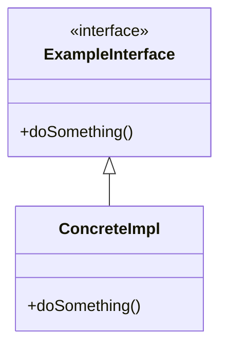
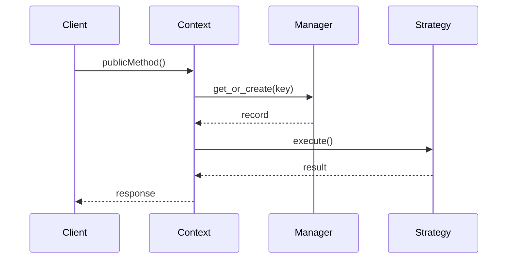

# LLD Implementation Template

Reusable structure for any LLD problem. Copy this file into the problem's folder as `implementation.md` and fill in each section in order — don't skip ahead to class diagrams before requirements are nailed down, and don't start coding before the class diagram is agreed.

---

## 1. Requirement

- **Functional requirements** — bullet list of what the system must do, ranked by priority (top 3-5 first).
- **Non-functional requirements** — scale, concurrency, latency, consistency expectations.
- **Clarifying questions** — the questions you'd actually ask an interviewer before designing anything. Write the assumed answer next to each if this is solo practice.

---

## 2. Core Entities

Table of nouns → responsibility. Keep each entity to one clear responsibility (SRP) — if a row needs "and" twice, it's probably two entities.

| Entity | Responsibility |
|---|---|
| | |

Then run it through the framework decision table:

| Question | Answer | Pattern |
|---|---|---|
| Does behavior change based on an internal mode/phase? | | State |
| Is there a swappable algorithm/behavior? | | Strategy |
| Does something manage a keyed collection of records? | | Manager (Registry-shaped) |
| Does anything need to notify other objects on change? | | Observer |
| What's the single public entry point? | | Context |

---

## 3. Class Diagram

Rules of thumb while drawing it:
- Interfaces/abstract classes first, concrete classes second.
- Show only the methods that matter for the core flow — skip getters/setters.
- Mark relationships explicitly: `<|--` inheritance/implementation, `*--` composition, `o--` aggregation, `-->` association/dependency.

---

## 4. Flow Diagram

A sequence diagram for the single most important use case — the one the interviewer will actually ask you to trace through.

If there's a branch (success/failure path), show both with `alt`/`else` blocks — that's usually where the interesting edge cases live.

---

## 5. Implementation

- **Folder/file layout** — following the established convention: `models/` (value objects/entities), `strategy/` (swappable algorithms), `manager/` (registries/collection owners), `states/` (if State pattern applies), top-level context class, top-level `main.py` demo.
- **Build order** (mirrors how you'd narrate it live):
  1. Interface(s) first.
  2. One concern fully working end-to-end (pick the hardest/most central one — prove it works before expanding surface area).
  3. A second concrete implementation of the same interface, to prove extensibility (OCP) actually holds.
  4. Manager/Registry wiring.
  5. Context — the one public class everything is reached through.
  6. `main.py` demo proving the core flow + at least one edge case.
- Keep a running note here of what's actually built vs. still pending as you go.

---

## 6. Think About Extensibility

For each, answer "what would I need to change, and what stays untouched":
- **New variant of the swappable behavior** (new Strategy) — should require a new class only, zero edits elsewhere.
- **New state/phase** — new State class + one new transition wired in; existing states untouched.
- **Scale to distributed / multi-process** — what breaks (in-process locks, in-memory dicts) and what the swap-in replacement looks like (DB-level atomicity, distributed lock, shared cache).
- **New notification/side-effect on an existing event** — new Observer only, subject class untouched.
- **Anything you're deliberately NOT building** — say so explicitly, and why (interviewers respect scoping decisions more than silent gaps).
