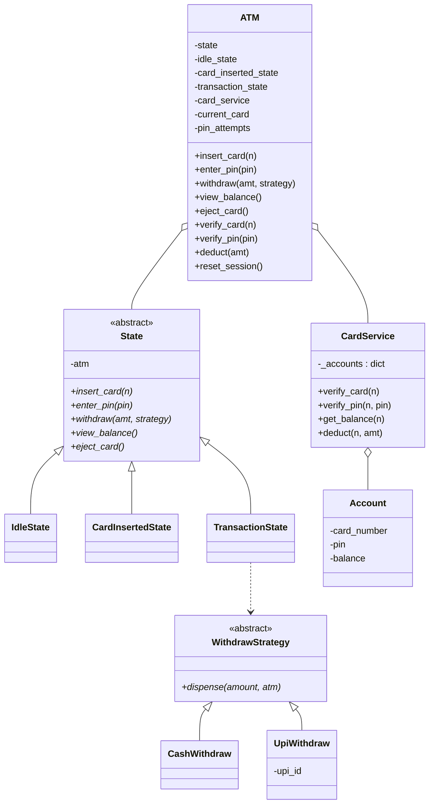

# ATM — LLD

> A consolidated, rehearse-the-night-before design doc. Read top-to-bottom once, then close it and rebuild §4 and §5 from memory — that's the practice loop. This doc matches the code actually in this folder; deliberate shortcuts are marked ⬜.

---

## 1. Understanding the Problem

We're designing the control logic for an ATM: a user inserts a card, enters a PIN, and — only if both check out — can view balance or withdraw cash. The machine is fundamentally a **sequence of gated steps**; you cannot withdraw before you've verified a PIN, and you cannot verify a PIN before a card is in.

The one thing that makes this non-trivial — and what an interviewer is really probing — is **how you stop the same set of actions from being legal in the wrong order without drowning every method in `if self.stage == ...` checks.** A naïve ATM becomes a swamp of status flags (`card_inserted`, `pin_ok`, `in_transaction`) consulted at the top of every operation. The clean answer is the **State pattern**: the machine *is* in a state object, and each state simply refuses the operations that don't belong to it. The second, smaller axis is that **the payout method varies** (cash vs. UPI transfer) — that's a Strategy, and it's important to see it's a *different kind of variation* than the state machine. Name both: *State for the step gating*, *Strategy for the payout*.

---

## 2. Requirements

### Clarifying Questions

**Candidate:** What's the core flow — insert card, PIN, then transactions?
**Interviewer:** Yes. Insert card → enter PIN → then the user can view balance and withdraw. Finally eject the card, which ends the session.

**Candidate:** What happens if someone tries to withdraw before inserting a card, or before the PIN is verified?
**Interviewer:** It must be rejected with a clear message — the machine shouldn't let you skip steps. Getting that gating right is the point.

**Candidate:** Wrong PIN — how many tries, and then what?
**Interviewer:** Three attempts. On the third failure, block the card and reset the machine to idle.

**Candidate:** Withdrawal — always cash? Or other rails?
**Interviewer:** Support more than one — cash dispensing and, say, a UPI/account transfer. I want it easy to add a new payout method later without touching the transaction flow.

**Candidate:** Where does the money actually live — is the account/balance the ATM's responsibility?
**Interviewer:** No. Assume a bank backend behind a service. The ATM calls it to verify and debit; it doesn't own accounts.

**Candidate:** Out of scope — deposits, receipts, real card hardware, real bank network, concurrency?
**Interviewer:** All out of scope. Single user at a time, mock the bank, no hardware.

### Final Requirements

**Functional**
- **Insert card** → **enter PIN** → **view balance** / **withdraw** → **eject card**, enforced *in that order*.
- Any operation attempted in the wrong step is **rejected with a message**, not executed.
- **3 PIN attempts**, then block the card and reset to idle.
- **Withdraw** debits the account (via the bank service) and then **dispenses** via a **pluggable payout method** (cash, UPI, …).
- **Eject** ends the session and returns the machine to idle.

**Non-Functional**
- Step-gating must be **centralized, not scattered** as flag checks in every method.
- Payout methods **extensible** without editing the transaction logic.
- Bank interaction isolated behind a **service** the states never touch directly.

**Out of Scope**
- Deposits, mini-statements/receipts, physical card & cash hardware.
- Real bank network / authentication crypto (mock service with in-memory accounts).
- Concurrency (one session at a time).

---

## 3. Core Entities and Relationships

Walking the nouns:

- **ATM** — the machine/context. Real class: it holds the current state, the shared session data (`current_card`, `pin_attempts`), and the card-service handle. Every public action delegates to the current state.
- **State** — insert-card / PIN / transaction stages. Real class (abstract): it's the whole point of the design. Concrete states: `IdleState`, `CardInsertedState`, `TransactionState`.
- **CardService** — verify card, verify PIN, get balance, debit. Real class: it stands in for the bank backend and is the *only* thing that touches `Account`. States and the ATM go through it.
- **Account** — card number, PIN, balance. A **data holder** owned by the service, not by the ATM. Barely a class (no behavior), but it's the record the service reads/mutates.
- **WithdrawStrategy** — cash vs. UPI payout. Real class (abstract): the pluggable dispensing rail. Concrete: `CashWithdraw`, `UpiWithdraw`.

**Entities considered and cut:**
- **`Card` class** — the code represents a card as just its `card_number` string. A `Card` object with no behavior beyond holding a number would be ceremony; cut. (If cards gained expiry/type, revisit — see §6.)
- **`Transaction` / `TransactionHistory`** — no requirement for logging/receipts, so no class. Cut.
- **`Screen` / `Keypad` / `CashDispenser` hardware** — out of scope; the payout *effect* is a Strategy, the I/O is `print`. Cut.
- **A `Bank` on top of `CardService`** — one layer of indirection is enough; a second wrapper adds nothing today. Cut.

| Entity | Responsibility |
|---|---|
| `ATM` (context) | Hold current state + session data (`current_card`, `pin_attempts`); delegate every action to the state; wrap `CardService` calls |
| `State` (abstract) + `Idle`/`CardInserted`/`Transaction` | Each state allows its legal actions and rejects the rest; drives state transitions |
| `CardService` | Bank backend stand-in: verify card/PIN, get balance, debit; sole owner of `Account`s |
| `Account` | Data record: card number, PIN, balance |
| `WithdrawStrategy` (abstract) + `Cash`/`Upi` | Pluggable payout rail invoked after a successful debit |

---

## 4. Class Design

### `ATM` — the context

State: three **pre-built** state instances (`idle_state`, `card_inserted_state`, `transaction_state`), a `state` pointer to the current one, a `card_service`, and session data `current_card` + `pin_attempts`.

Public actions all delegate: `insert_card`, `enter_pin`, `withdraw`, `view_balance`, `eject_card` each just call `self.state.<same_method>(...)`. Plus **service wrappers** (`verify_card`, `verify_pin`, `get_balance`, `deduct`) and `reset_session()`.

| Requirement | Tracked via |
|---|---|
| Which step we're in | `self.state` pointer (not a set of booleans) |
| Which card this session | `self.current_card` |
| 3-attempt PIN lockout | `self.pin_attempts` |
| End/blocked session cleanup | `reset_session()` clears card + attempts + returns to `idle_state` |

**Two design choices worth defending:**

*Why pre-build all three states in the constructor instead of `new`-ing them on each transition?* The states are stateless flyweights — all mutable session data lives on the ATM, not the state. So one instance of each is enough, transitions are just pointer swaps (`self.state = self.transaction_state`), and there's zero allocation churn. If states *held* per-session data you'd construct them per session; they don't, so you don't.

*Why do states go through ATM wrappers (`self.atm.verify_pin(pin)`) instead of calling `card_service` directly?* It keeps the states ignorant of *how* the bank is reached — the ATM owns that wiring. Swap the service (mock → real) and no state changes. The states' job is **flow control**, not integration.

**Anti-pattern check — is the State pattern justified, or pattern-for-its-own-sake?** Justified, and this is the textbook case *for* it. There are genuinely distinct legal action-sets per step, the same method (`withdraw`) must behave differently (reject vs. execute) depending on step, and the number of steps is small and fixed. The alternative — flags checked in every method — is exactly the swamp §1 named. This is the one problem where reaching for State first is correct rather than premature.

### The `State` hierarchy

Abstract `State(atm)` declares all five actions. Each concrete state implements all five: the legal ones do work, the illegal ones print a rejection. This is the "each state answers the whole interface, most methods just say no" shape.

**`IdleState`** — only `insert_card` does anything real:
```
insert_card(card_number):
    if not atm.verify_card(card_number): print("Invalid card."); return
    atm.current_card = card_number
    atm.state = atm.card_inserted_state          # advance
enter_pin / withdraw / view_balance -> "Please insert your card first."
eject_card -> "No card inserted."
```

**`CardInsertedState`** — owns PIN verification *and the 3-attempt lockout*:
```
enter_pin(pin):
    if not atm.verify_pin(pin):
        atm.pin_attempts += 1
        remaining = MAX_PIN_ATTEMPTS - atm.pin_attempts   # MAX = 3
        if remaining == 0:
            print("Too many wrong attempts. Card blocked.")
            atm.reset_session()                  # back to idle
            return
        print(f"Wrong PIN. {remaining} attempt(s) left."); return
    atm.pin_attempts = 0
    atm.state = atm.transaction_state            # advance
withdraw / view_balance -> "Please verify your PIN first."
eject_card -> reset_session()                    # allowed: user backs out
insert_card -> "Card already inserted."
```

**`TransactionState`** — the only place withdraw/balance actually run:
```
withdraw(amount, strategy):
    success = atm.deduct(amount)                 # debit first
    if success: strategy.dispense(amount, atm)   # then pay out
view_balance() -> print(atm.get_balance())
eject_card() -> reset_session()
insert_card / enter_pin -> already-done messages
```

| Requirement | Which state enforces it |
|---|---|
| No PIN before card | `IdleState.enter_pin` rejects |
| No withdraw before PIN | `CardInsertedState.withdraw` rejects |
| 3-strike lockout | `CardInsertedState.enter_pin` counter + `reset_session()` |
| Debit-before-dispense | `TransactionState.withdraw` (deduct → dispense) |

**Debit-before-dispense is the correctness-critical ordering.** `deduct` returns False on insufficient funds and the strategy never runs — so we never dispense money we didn't successfully debit. Reverse the order and a failed debit could still pay out. ⬜ *Honesty note:* the built code has no rollback — if `deduct` succeeds but `dispense` later fails, the account is already debited with no compensation. Real ATMs need a reversal; call this out (see §6).

### `WithdrawStrategy` — the payout rail

Abstract: `dispense(amount, atm)`. Concretes:
```
CashWithdraw.dispense(amount, atm)  -> print "Dispensing $amount in cash."
UpiWithdraw(upi_id).dispense(amount, atm) -> print "Transferring $amount to <upi_id>"
```
Note `UpiWithdraw` takes its extra datum (`upi_id`) in the **constructor**, keeping the `dispense` signature uniform across strategies. That's the trick that lets `TransactionState.withdraw` call `strategy.dispense(amount, atm)` without knowing which rail it is.

**Anti-pattern check — Strategy for two payout types, is it worth it?** Yes: the interviewer stated "easy to add a new payout method without touching the transaction flow" — real, stated variation, and already two implementations with a third implied. Without it, `TransactionState.withdraw` grows an `if kind == "cash" ... elif kind == "upi"` that every new rail edits. Note this is a *cleaner* Strategy case than most because the varying data (`upi_id`) is absorbed into the constructor, so the call site stays polymorphic.

**Why State *and* Strategy in one design?** They solve orthogonal problems and it's worth saying so: **State** answers "*is this action allowed right now?*" (temporal gating); **Strategy** answers "*how do we carry out this one action?*" (payout variation). Conflating them — e.g. a `CashTransactionState` vs `UpiTransactionState` — would multiply states by payout rails combinatorially. Keeping them separate is the design insight.

### Class diagram



---

## 5. Implementation

The hard part from §1 is **the step-gating**. Let's build up to State, then trace the two tricky flows (lockout, and action-in-wrong-state).

### The core mechanism — from flags to State

**Bad — status flags checked in every method.**
*Approach:* `ATM` holds booleans `card_inserted`, `pin_verified`. Every method opens with guards: `def withdraw(...): if not self.card_inserted: return ...; if not self.pin_verified: return ...`.
*Challenges:* The guard block is copy-pasted into every action and must be kept in sync. Adding a step (say, language selection) means editing *every* method. Illegal combinations (`pin_verified=True` but `card_inserted=False`) are representable and must be defended against.
*Tradeoffs:* Trivial to start, unmaintainable at 5+ steps, and bug-prone because the "which steps are valid" logic is smeared across the class.

**Good — a single `stage` enum + one dispatch switch.**
*Approach:* Replace booleans with one `stage` enum, and each method switches on it. Illegal states are no longer representable (one variable, one value).
*Challenges:* Better, but every method still contains the full `match stage:` ladder, and the transition logic is duplicated across methods. The behavior for "withdraw while idle" lives in `withdraw`, far from the behavior for "PIN while idle" in `enter_pin` — the idle rules are scattered.
*Tradeoffs:* Collapses the invalid-state bug, but the per-method switch still grows with steps. This is the "acceptable for a small machine" tier.

**Great — the State pattern (what's built).**
*Approach:* Each stage is an object implementing the full action interface. The ATM holds a `state` pointer and blindly delegates. A state's *legal* actions do work and may reassign `atm.state`; its *illegal* actions print a rejection. All rules for "being idle" live in one `IdleState` class.
*Tradeoffs:* More classes up front. Payoff: adding a step = adding one class; the ATM and other states barely change. Each state is independently readable ("what can I do here? read this one file"). Transitions are explicit assignments, not implied by scattered flag writes.

```python
# atm.py — the context delegates everything
class ATM:
    def __init__(self):
        self.idle_state = IdleState(self)
        self.card_inserted_state = CardInsertedState(self)
        self.transaction_state = TransactionState(self)
        self.state = self.idle_state
        self.card_service = CardService()
        self.current_card = None
        self.pin_attempts = 0

    def insert_card(self, n):      self.state.insert_card(n)
    def enter_pin(self, pin):      self.state.enter_pin(pin)
    def withdraw(self, amt, strat):self.state.withdraw(amt, strat)
    def view_balance(self):        self.state.view_balance()
    def eject_card(self):          self.state.eject_card()

    def verify_card(self, n):      return self.card_service.verify_card(n)
    def verify_pin(self, pin):     return self.card_service.verify_pin(self.current_card, pin)
    def get_balance(self):         return self.card_service.get_balance(self.current_card)
    def deduct(self, amt):         return self.card_service.deduct(self.current_card, amt)

    def reset_session(self):
        self.current_card = None
        self.pin_attempts = 0
        self.state = self.idle_state
```

**Why not let states hold the `card_service` and `pin_attempts` themselves?** Because those are *session*-scoped, shared across states within one session. Putting them on the ATM (the context) means a transition doesn't have to hand data from one state to the next — the shared scratchpad is the ATM. States stay stateless and reusable.

### Verification trace 1 — the 3-strike lockout

Start: `IdleState`, `pin_attempts=0`. User inserts valid card "1234" (real PIN "0000"), then types the wrong PIN three times.

| Step | Call | State-side logic | ATM after |
|---|---|---|---|
| 1 | `insert_card("1234")` | `verify_card` ok → set `current_card` | state=**CardInserted**, card=1234 |
| 2 | `enter_pin("9999")` | wrong → `pin_attempts=1`, remaining=2 → "2 left" | state=CardInserted, attempts=1 |
| 3 | `enter_pin("9999")` | wrong → `pin_attempts=2`, remaining=1 → "1 left" | state=CardInserted, attempts=2 |
| 4 | `enter_pin("9999")` | wrong → `pin_attempts=3`, remaining=0 → "Card blocked" → `reset_session()` | state=**Idle**, card=None, attempts=0 |

After the third strike the machine is back to a clean idle — no card, counter zeroed — so the *next* customer starts fresh. The counter and the reset both live in one place (`CardInsertedState.enter_pin` + `reset_session`), which is the maintainability win.

### Verification trace 2 — action in the wrong state (the whole point)

From a fresh machine (`IdleState`), user calls `withdraw(100, CashWithdraw())` without inserting a card.

```
ATM.withdraw  -> self.state.withdraw          # state is IdleState
IdleState.withdraw -> print("Please insert your card first.")   # rejected, no debit
```
No balance touched, no dispense, machine unchanged. The rejection is *data-local to `IdleState`* — the ATM didn't need an `if`; it just delegated and the state said no. That's the swamp from §1 avoided.

### Verification trace 3 — happy withdrawal (debit-then-dispense ordering)

`TransactionState`, card 1234 (balance 5000), `withdraw(1000, CashWithdraw())`:
```
TransactionState.withdraw:
    success = atm.deduct(1000)     # CardService: 5000 >= 1000 -> balance=4000, returns True
    if success: CashWithdraw.dispense(1000, atm)   # prints "Dispensing $1000.00 in cash."
```
Now the failure branch: `withdraw(9999, ...)` with balance 4000 → `deduct` prints "Insufficient funds", returns False → `dispense` never runs. Money is only ever paid out *after* a confirmed debit.

---

## 6. Extensibility

**Add a new payout rail — crypto, cheque, wallet `(Mid+)`.** One new `WithdrawStrategy` subclass; if it needs extra data (a wallet address) it takes it in the constructor like `UpiWithdraw` does with `upi_id`. `TransactionState.withdraw` and every other class are untouched — the exact payoff the Strategy abstraction was bought for.

**Add a transaction step — mini-statement, deposit, PIN-change `(Mid+)`.** Deposit and mini-statement are new methods in `TransactionState` (you're already PIN-verified there). A *new stage* — e.g. a language-selection screen before PIN — is a new `State` class inserted into the transition chain, with the neighboring states repointed. No method acquires a new flag check; that's the State pattern earning its keep.

**Debit/dispense failure rollback `(Senior)`.** Today debit-then-dispense has no compensation if dispense fails after a successful debit. Make `withdraw` transactional: on `dispense` failure, call a `CardService.credit(amount)` reversal (or model the whole thing as a two-phase reserve→commit). This touches `TransactionState.withdraw` and `CardService`; recognizing that the *current* code silently drops money on a dispense failure is the senior-level catch.

**Real card objects with expiry/type `(Senior)`.** The `Card`-as-string shortcut breaks once a card has an expiry date, network (Visa/MC), or debit/credit type. Introduce a `Card` class and have `CardService.verify_card` check expiry. `IdleState.insert_card` gains an expiry check; the state machine shape is unchanged — the change is localized because the service already isolates bank concerns from flow control.

---

## 7. What's Expected at Each Level

**Junior**
- Recognize the ordered flow and implement *some* gating (even flags), plus the 3-strike counter.
- A working withdraw that debits then dispenses, and a card/PIN verification path.

**Mid-level**
- Reach for the State pattern deliberately and explain why flags don't scale.
- Strategy for payout with the constructor-injected-data trick, and articulate that State and Strategy solve *orthogonal* problems (gating vs. how).
- Isolate the bank behind `CardService` so states stay integration-agnostic.

**Senior**
- Drive the stateless-flyweight state instances + context-owned session data decision.
- Catch the missing debit/dispense rollback and propose reserve→commit or reversal.
- Weigh what stays a data-holder (`Account`, card-as-string) vs. what earns a class, and defend *not* over-modeling (`Card`, `Transaction`, hardware) until a requirement demands it.
