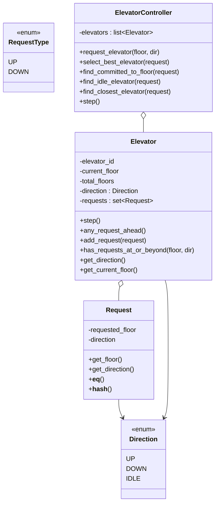

# Elevator System — LLD

> A consolidated, rehearse-the-night-before design doc. Read top-to-bottom once, then close it and rebuild §4 and §5 from memory — that's the practice loop. This doc matches the code actually in this folder; deliberate shortcuts and half-built pieces are marked ⬜.

---

## 1. Understanding the Problem

We're designing the control logic for a bank of elevators in a building. People press a hall button on some floor ("I want to go UP from floor 3"); the system must pick *which* car answers, and each car must decide, tick by tick, where to move next so it serves its pending requests efficiently.

This is the rare LLD problem where **the algorithm, not the object model, is the hard part**. Two distinct decisions have to be right, and an interviewer probes both:

1. **Dispatch** — given a new hall call, which car should take it? A car already heading that way and about to pass the floor is far better than an idle car across the building.
2. **Movement (the SCAN/LOOK idea)** — a single car should sweep in one direction serving everything on the way, then reverse — *not* greedily bounce to the nearest button and thrash. The moment you say "go to the nearest request" you've built an elevator that oscillates and starves far floors.

Name both explicitly: *multi-car dispatch* and *single-car directional sweep (LOOK)*.

---

## 2. Requirements

### Clarifying Questions

**Candidate:** Multiple elevators, or one? And what triggers a request?
**Interviewer:** A bank of N elevators. A request is a hall call: a floor plus a desired direction (UP or DOWN).

**Candidate:** When a request comes in, do we assign it to a specific car immediately, or to a shared pool?
**Interviewer:** Assign it to the best single car at request time. That car then owns it.

**Candidate:** How should a car move — nearest button first, or sweep?
**Interviewer:** Sweep. Keep going in the current direction serving requests on the way, and only reverse when there's nothing left ahead. Don't ping-pong.

**Candidate:** How does time advance — do I model continuous motion or discrete steps?
**Interviewer:** Discrete. A `step()` advances every car one floor (or serves the current floor). We simulate tick by tick.

**Candidate:** Do I need to model the buttons *inside* the car (car calls to a destination), weight limits, doors?
**Interviewer:** Keep the core to hall calls and movement for now. Note where car-calls/doors would slot in, but don't build them.

**Candidate:** Out of scope — persistence, real-time timing, capacity, UI?
**Interviewer:** All out of scope. In-memory, single-threaded, discrete ticks.

### Final Requirements

**Functional**
- **Register a hall call**: (floor, direction) → the system picks the **best elevator** and assigns it.
- Each elevator **moves via a directional sweep (LOOK)**: continue in the current direction while requests remain ahead; reverse only when nothing is ahead; go **IDLE** when empty.
- **Dispatch policy** prefers, in order: a car already **committed & about to pass** the floor same-direction → an **idle** car → the globally **closest** car.
- **Discrete simulation**: `controller.step()` advances all cars one tick.
- Reject **invalid floors** (out of `[0, total_floors)`).

**Non-Functional**
- No **ping-ponging / starvation** — the sweep must not thrash between near buttons.
- **Extensible** dispatch policy and request types (car calls later).

**Out of Scope**
- Car-call (in-car destination) buttons ⬜ *partially stubbed, see §4/§5*, doors, weight/capacity.
- Real timing, threads, persistence, UI.

---

## 3. Core Entities and Relationships

Walking the nouns:

- **Elevator** — the car. Real class, and the richest one: it owns its `current_floor`, `direction`, and its **set of pending requests**, and it contains the entire single-car movement algorithm (`step`, `any_request_ahead`, `has_requests_at_or_beyond`).
- **ElevatorController** — the dispatcher. Real class: holds all cars, picks the best one for a new request, and drives the global `step()`. This is where the multi-car policy lives.
- **Request** — a (floor, direction) pair. Real class *because it needs value-equality*: requests live in a `set()`, so `Request` implements `__eq__`/`__hash__` to dedupe by (floor, direction).
- **Direction** — UP / DOWN / **IDLE**. Enum. IDLE is a genuine third state (a parked car), not just "no direction," which is why it's here and not a boolean.
- **RequestType** — UP / DOWN enum. ⬜ *Present in the code but currently unused* — `Request` carries a `Direction` instead. Candidate cut: it's redundant with `Direction`'s UP/DOWN; keeping both is the kind of duplicate vocabulary to prune.

**Entities considered and cut:**
- **`Building` / `Floor`** — a floor is just an integer here; there's no per-floor behavior (no call buttons modeled as objects). A `Floor` class would be a data-less wrapper. Cut.
- **`Door` / `Panel` / `Passenger`** — out of scope. Cut.
- **A separate `Scheduler` strategy object** — the dispatch policy currently lives as three methods on the controller. Whether to extract a Strategy is a real judgment call (see §4 anti-pattern check); today it's *not* extracted, and that's defensible.

| Entity | Responsibility |
|---|---|
| `Elevator` | Own floor/direction/pending-requests; run the single-car LOOK sweep in `step()`; answer "any request ahead?" and "requests at-or-beyond floor?" |
| `ElevatorController` | Hold all cars; pick the best car for a new request (3-tier policy); drive global `step()` |
| `Request` | Value object (floor, direction) with `__eq__`/`__hash__` for set membership/dedup |
| `Direction` (enum) | UP / DOWN / IDLE — IDLE is a real parked state |
| `RequestType` (enum) | ⬜ Unused duplicate of Direction's UP/DOWN — candidate for removal |

---

## 4. Class Design

### `Request` — why it's a real value object

State: `requested_floor`, `direction`. Methods: `get_floor`, `get_direction`, and crucially `__eq__` + `__hash__` over `(floor, direction)`.

**Why the dunder methods matter:** the elevator stores requests in a `set()`. Without `__eq__`/`__hash__`, two `Request(3, UP)` objects would be distinct set members, so the same hall call pressed twice would be stored twice and "have we served floor 3 UP?" checks would fail. Value-equality makes the set dedupe by *meaning*, and lets `pickup_request in self.requests` work as an O(1) membership test. This is the one place a plain data class isn't enough — it needs identity-by-value.

### `Elevator` — the single-car sweep

State: `elevator_id`, `current_floor` (default 0), `total_floors` (default 10), `direction` (starts IDLE), `requests: set[Request]`.

Methods: `step()` (advance one tick), `any_request_ahead()`, `add_request()`, `has_requests_at_or_beyond(floor, direction)`, plus getters.

| Requirement | Tracked via |
|---|---|
| Where the car is | `current_floor` |
| Which way it's sweeping | `direction` (UP/DOWN/IDLE) |
| What it still must serve | `requests` set (deduped) |
| Valid-floor guard | `add_request` checks `0 <= floor < total_floors` |
| "Should I keep going or reverse?" | `any_request_ahead()` |
| Dispatch: "is this car useful for that call?" | `has_requests_at_or_beyond(floor, dir)` |

**Good vs. Great — how the car chooses its next move:**

*Good — greedy nearest-request.* Each tick, find the closest pending floor and move one step toward it. Simple. Breaks badly: a car at floor 5 with requests at {6, 4} will serve 6, then if a request appears at 5 it whipsaws back — near floors keep stealing priority and floor 10 waits forever. This is the ping-pong the requirements forbid.

*Great — directional LOOK sweep (what's built).* The car commits to a `direction` and keeps moving that way as long as `any_request_ahead()` is true, serving every request it passes. Only when nothing remains ahead does it reverse. An empty request set drops it to IDLE. This bounds worst-case wait (a floor is served within one full sweep) and eliminates thrash. The cost is a bit more state (you must track direction and "ahead-ness"), which is exactly what the extra methods provide.

**Anti-pattern check — should the sweep be a Strategy object?** Not yet. There's exactly *one* movement algorithm (LOOK) and no stated requirement for a second. Extracting a `MovementStrategy` now would be indirection with no payoff. Contrast with the *dispatch* policy below, where there's a stronger case. Only split the sweep out if a real second policy appears (e.g. an express/zoned car).

### `ElevatorController` — multi-car dispatch

State: `elevators: list[Elevator]`. Methods: `request_elevator`, `select_best_elevator`, and the three tiers `find_committed_to_floor` / `find_idle_elevator` / `find_closest_elevator`, plus `step()`.

The dispatch policy is a **prioritized fallback**, tried in order:

1. **`find_committed_to_floor`** — a car already moving the *same* direction as the request, positioned so it will *pass* the request floor (UP car below the floor / DOWN car above), and which *already has a request at-or-beyond* that floor (so it's genuinely committed to sweep past). Among those, the nearest. This is the ideal: the call is served "for free" on an existing sweep.
2. **`find_idle_elevator`** — no committed car? Take the nearest IDLE car and wake it up.
3. **`find_closest_elevator`** — nothing idle either? Fall back to the globally nearest car (it'll get to the request after finishing its current sweep).

| Dispatch tier | When it wins | Why it's preferred over the next |
|---|---|---|
| Committed & passing | A same-direction car will sweep past anyway | Zero extra travel — piggybacks an existing sweep |
| Idle | No free sweep available | Waking a parked car beats diverting a busy one |
| Closest | Everything is busy & mis-directed | Least-bad: minimize eventual travel |

**Anti-pattern check — three methods vs. a Strategy pattern for dispatch.** *Here* the case for extraction is real: dispatch policy is a classic thing interviewers ask to swap ("now optimize for energy, or for wait-time fairness"). The current code keeps it as three concrete methods on the controller, which is fine for one policy and keeps everything in one readable place. The honest framing: *if* the interviewer asks for a second policy, extract a `DispatchStrategy` interface and move these three methods behind one implementation of it — that's a clean, additive refactor. Pre-extracting it before that ask would be speculative. (This is the mirror image of the parking-lot fare decision, where the second rule *was* stated up front — so there, the Strategy was justified immediately.)

### Class diagram



---

## 5. Implementation

Two hard parts: **(A) the single-car LOOK sweep** (`Elevator.step`) and **(B) the multi-car dispatch** (`ElevatorController.select_best_elevator`). We build A first because dispatch tier 1 *depends on* the sweep's notion of "committed."

### Part A — `Elevator.step()`, the sweep

**Bad — teleport to nearest request.**
*Approach:* `next = min(requests, key=dist); current_floor = next.floor; requests.discard(next)`.
*Challenges:* No notion of direction; serves nearest regardless of who's been waiting longest; a stream of near requests starves far ones.
*Tradeoffs:* One line, but it's not an elevator — it's a random-access seeker. Fails the anti-ping-pong requirement.

**Good — nearest, but move one floor at a time.**
*Approach:* Pick nearest target, step one floor toward it each tick.
*Challenges:* Still re-picks "nearest" every tick, so a new closer request mid-travel yanks the car around. Direction isn't *committed*, so it whipsaws.
*Tradeoffs:* Feels smoother but still thrashes; still starves.

**Great — commit to a direction, sweep, reverse only when clear (what's built).**
*Approach:* (1) If no requests → IDLE, done. (2) If currently IDLE but requests exist → pick a direction toward the nearest request to *start* a sweep. (3) If the current floor matches a request for this sweep, serve it (discard from the set) and stop for this tick. (4) Else, if nothing remains ahead in the current direction, reverse. (5) Move one floor in the (possibly reversed) direction.

```python
def step(self):
    if not self.requests:                          # (1) nothing to do
        self.direction = Direction.IDLE
        return

    if self.direction == Direction.IDLE:           # (2) start a sweep toward nearest
        nearest = min(self.requests,
                      key=lambda r: abs(self.current_floor - r.requested_floor))
        self.direction = (Direction.UP
                          if nearest.requested_floor > self.current_floor
                          else Direction.DOWN)

    # (3) are we AT a request for this floor? (hall call same-dir, or a car-call)
    pickup_request      = Request(self.current_floor, self.direction)
    destination_request = Request(self.current_floor, Direction.IDLE)   # ⬜ car-call slot
    if pickup_request in self.requests or destination_request in self.requests:
        self.requests.discard(pickup_request)
        self.requests.discard(destination_request)
        if not self.requests:
            self.direction = Direction.IDLE
        return

    if not self.any_request_ahead():               # (4) nothing ahead -> reverse
        self.direction = (Direction.DOWN if self.direction == Direction.UP
                          else Direction.UP)

    if self.direction == Direction.UP:             # (5) advance one floor
        self.current_floor += 1
    elif self.direction == Direction.DOWN:
        self.current_floor -= 1
```

**Why the two request objects (`pickup_request` vs `destination_request`)?** A hall call carries a direction (`Request(floor, UP)`) — you only serve it if the car is sweeping *that* way. A **car call** (someone inside pressed a floor) has no direction — modeled as `Request(floor, IDLE)` — and should be served regardless of sweep direction. The code checks both, which is why it *reserves* the car-call concept. ⬜ **Honest gap:** nothing currently *creates* an IDLE-direction request — there's no "press floor button inside" API — so the `destination_request` branch is a hook that's wired but never fired yet. Say this plainly in an interview rather than claiming car-calls work.

**Why reverse only via `any_request_ahead()` and not "reached the top"?** LOOK (reverse when no request ahead) beats SCAN (always ride to the physical end) because it never travels past the last request — less wasted motion. The building's `total_floors` bounds `add_request`, not the sweep.

### Part B — `select_best_elevator`, dispatch

Full winning code:
```python
def select_best_elevator(self, request):
    best = self.find_committed_to_floor(request)   # tier 1: piggyback a sweep
    if best is not None: return best
    best = self.find_idle_elevator(request)        # tier 2: wake nearest parked car
    if best is not None: return best
    return self.find_closest_elevator(request)     # tier 3: least-bad fallback

def find_committed_to_floor(self, request):
    rf = request.get_floor(); best, min_d = None, inf
    for e in self.elevators:
        if e.get_direction() != request.get_direction():          # must match direction
            continue
        if (e.get_direction() == Direction.UP   and e.get_current_floor() > rf) or \
           (e.get_direction() == Direction.DOWN and e.get_current_floor() < rf):
            continue                                              # already past the floor
        if not e.has_requests_at_or_beyond(rf, request.get_direction()):
            continue                                              # not truly committed past rf
        d = abs(e.get_current_floor() - rf)
        if d < min_d: min_d, best = d, e
    return best
```

**Why the `has_requests_at_or_beyond` filter in tier 1?** A same-direction car positioned before the floor *looks* ideal, but if its own requests all lie *before* the request floor, it will reverse before reaching it — so it isn't actually going to pass. Requiring an existing request at-or-beyond the floor guarantees the sweep genuinely carries past the new call. Without this check, tier 1 would hand calls to cars that turn around early.

### Verification trace — one car, a full sweep

Elevator E at floor 0, IDLE. Hall calls arrive (via `controller.request_elevator`, all assigned to E since it's the only car): `(3, UP)`, `(5, UP)`, `(1, UP)`. Then we `step()` repeatedly.

| Tick | Before | Logic | After (floor, dir, requests) |
|---|---|---|---|
| — | 0, IDLE, {} | 3 calls added | 0, IDLE, {3U,5U,1U} |
| 1 | 0, IDLE | IDLE→pick nearest (1) → dir UP; floor 0 not a request; ahead? yes → move up | 1, UP, {3U,5U,1U} |
| 2 | 1, UP | `Request(1,UP)` ∈ set → **serve floor 1**, discard, stop | 1, UP, {3U,5U} |
| 3 | 1, UP | floor 1 not in set now; ahead (3,5)? yes → move up | 2, UP, {3U,5U} |
| 4 | 2, UP | not a request; ahead? yes → up | 3, UP, {3U,5U} |
| 5 | 3, UP | `Request(3,UP)` ∈ set → **serve floor 3**, stop | 3, UP, {5U} |
| 6 | 3, UP | ahead (5)? yes → up | 4, UP, {5U} |
| 7 | 4, UP | ahead? yes → up | 5, UP, {5U} |
| 8 | 5, UP | `Request(5,UP)` ∈ set → **serve floor 5**; set now empty → **IDLE** | 5, IDLE, {} |

The car swept 0→5 once, served 1-3-5 in floor order (never doubling back for the later-arriving `(1,UP)`), and parked. No ping-pong, no starvation — exactly the LOOK behavior §1 required.

⬜ **Note on the missing driver:** there's no `main.py` in this folder, so the above is the intended simulation loop (`while any car busy: controller.step()`), not a copy of an existing script. Worth adding a driver for runnable proof.

---

## 6. Extensibility

**Car-call buttons (in-car destination selection) `(Mid+)`.** The hook already exists: `step()` checks `Request(floor, IDLE)`. Add a `press_floor(floor)` on `Elevator` that inserts `Request(floor, Direction.IDLE)` into `requests`. The sweep serves it regardless of direction (as designed). Nothing else changes — this is the cleanest extension because the code was shaped for it in advance.

**Swappable dispatch policy — optimize energy or fairness `(Mid+)`.** Extract the three `find_*` methods behind a `DispatchStrategy` interface with one `select(request, elevators)` method; the current logic becomes `NearestCommittedStrategy`. `request_elevator` calls `self.strategy.select(...)`. Additive, no elevator/movement change. This is the refactor to reach for *when the second policy is actually requested* — not before.

**Remove the dead `RequestType` enum / unify vocabulary `(Mid+)`.** `RequestType(UP/DOWN)` duplicates `Direction(UP/DOWN)` and is unused. Deleting it (and confirming `Request` uses `Direction` throughout) is a small correctness/clarity win — the kind of dead-code prune a careful candidate notices.

**Weight/capacity & door timing `(Senior)`.** Add a capacity counter to `Elevator` and make it skip (not serve) a request when full, re-queueing it to the controller. Doors introduce sub-floor time states, pushing `step()` toward a richer per-tick state machine (MOVING / DOORS_OPEN / DWELL). Recognizing that this turns the simple `step()` into a mini state machine — and that capacity re-queuing feeds *back* into dispatch — is the senior-level systems insight.

---

## 7. What's Expected at Each Level

**Junior**
- Model `Elevator`, `Request`, `Direction` cleanly; store requests in a set.
- A movement loop that at least moves toward requests — even if it's greedy, *know* that greedy ping-pongs.

**Mid-level**
- Implement the directional LOOK sweep (commit direction, serve on the way, reverse only when clear) and explain why it beats nearest-first.
- Give `Request` value-equality and explain why the set needs it.
- A tiered dispatch policy, and the judgment to keep it as methods until a second policy is asked for.

**Senior**
- Drive the `has_requests_at_or_beyond` "genuinely committed" nuance in dispatch, and the hall-call-vs-car-call (`direction` vs `IDLE`) distinction — including honestly flagging that car-calls are stubbed, not built.
- See dispatch as a Strategy seam and know *when* extracting it is justified vs. speculative.
- Reason about capacity re-queuing and door timing turning `step()` into a richer state machine, and prune dead vocabulary (`RequestType`).
