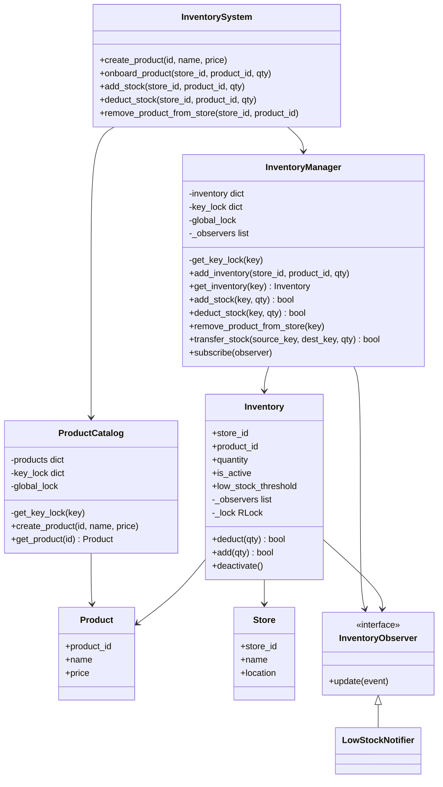

# Inventory Management System

## Understanding the Problem

A quick-commerce platform (Blinkit/Zepto-style) needs to track how much of each product sits at each of its stores, let that stock be created and updated, and warn ops when something is running low — at a scale of millions of products across many stores. The one thing that makes this non-trivial isn't the CRUD surface, which is mechanical — it's **concurrency correctness under two different kinds of race**: many requests mutating the *same* product's stock at the *same* store simultaneously (must never oversell), and multiple admins trying to *onboard* a brand-new product-at-store record at the same time (a different race, on the collection itself, not on any single record). Everything else in this design exists to serve that one requirement cleanly.

---

## Requirements

**Clarifying Questions**

**Candidate:** When you say "create, update products inside a store" — is that catalog-level data (name, price) or the per-store stock count, or both?
**Interviewer:** Both, and they're different things — a product has global catalog data shared across every store, but each store tracks its own quantity independently.

**Candidate:** Should placing an order, checkout, or payment be part of this system?
**Interviewer:** No — that's a separate service. This system only tracks and mutates stock; something else decides when to call it.

**Candidate:** Do we need to support holding stock temporarily — like a cart reservation — before committing a deduction?
**Interviewer:** No, keep it simple. Stock changes should be direct: create, update, deduct. No reserve-then-confirm flow.

**Candidate:** What happens if two requests hit the same product at the same store at the same instant?
**Interviewer:** That's the crux of this problem — the system must be thread-safe. Handle it correctly, not just claim to.

**Candidate:** Do we need stock transfer between stores?
**Interviewer:** Yes — moving stock from one store's inventory to another's needs to be supported, and it needs to be atomic: either the full quantity moves, or nothing does.

**Candidate:** What about a way to find which warehouse can fulfill a given quantity of a product?
**Interviewer:** That one's still out of scope — no cross-store availability query/routing.

**Candidate:** At "millions of products," should I worry about the data structure and lock footprint, or is in-memory fine for the design?
**Interviewer:** In-memory is fine to build against, but be ready to talk about what breaks at that scale and how you'd fix it.

**Final Requirements**

**Functional**
- Manage millions of products.
- Create and update products inside a store (both catalog-level product data, and per-store stock quantity).
- Each store is managed by an inventory management system.
- Low-stock alerts.
- Stock transfer between stores/warehouses — atomically: the full quantity moves, or none does.

**Non-Functional**
- Thread safety under concurrent operations — the central requirement this design is built around.

**Out of Scope**
- Check availability — given a product and quantity, return which warehouses can fulfill it (no cross-store query/routing at all).
- Ordering, checkout, cart, payment — a separate bounded context that would call into this system, not live inside it.
- Reservation / hold-with-expiry (reserve → confirm → release) — considered, deliberately dropped to keep this build simple and tightly matched to the spec above, which never asks for a claim-then-commit flow.

---

## Core Entities and Relationships

Working through the nouns in the requirements:

- **Product** — has real data (name, price) that's the same regardless of which store you're looking at. Earns a class.
- **Store** — an identity (id, name, location). Right now it's pure data with no behavior of its own — no dedicated `Store` registry/manager exists yet, because nothing in the current requirements needs to look one up by anything other than the id already embedded in `Inventory`'s key. Worth naming as a simplification, not hiding it.
- **Inventory** — the mutable, per-`(store_id, product_id)` stock count. This is where all the concurrency-critical logic lives, and it's the most important class in the whole design.
- **Order / Reservation** — considered, both cut. An order-placing customer and a temporary stock hold are both things an *external* Order/Checkout service would model, not this system — see Out of Scope above. Modeling them here would be solving a problem that wasn't asked for.
- **StoreSelectionStrategy** (which store should fulfill a request) — considered, cut. This only matters if the system does cross-store availability routing, which is explicitly out of scope. Building it anyway would be speculative generality.
- **ProductCatalog** — doesn't map to a requirements noun directly, but earns its own class once you notice `Product` needs somewhere to actually live: a keyed collection with its own create-time concurrency concern (see Class Design). Same shape as `InventoryManager`, one level up.
- **InventoryManager** — owns the collection of `Inventory` records, keyed by `(store_id, product_id)`.
- **InventoryObserver / LowStockNotifier** — the low-stock alert requirement needs *something* to fire when quantity drops below a threshold, decoupled from whatever `Inventory` itself does. Genuine Observer use case (see the anti-pattern check in Class Design for *why* this one's different from the Strategy/State classes that got cut).

| Entity | Responsibility |
|---|---|
| `Product` | Catalog data — id, name, price. Read-heavy, identical across every store. |
| `ProductCatalog` | Owns all `Product`s, keyed by `product_id`. Create + read only — no update/delete yet (see Class Design). |
| `Store` | Identity — id, name, location. No behavior, no dedicated manager (open gap, noted honestly). |
| `Inventory` | One record per `(store_id, product_id)` — the actual concurrency-controlled stock count. |
| `InventoryManager` | Owns all `Inventory` records, keyed by `(store_id, product_id)`. Routes mutations to the right record; owns the create-time locking; coordinates atomic transfers between two records. |
| `InventoryObserver` / `LowStockNotifier` | Reacts to a low-stock event, fired by `Inventory` when quantity crosses its threshold. |
| `InventorySystem` | The one public entry point — thin pass-through to `ProductCatalog` + `InventoryManager`. |

---

## Class Design

### Inventory
```
Inventory:
  product_id, store_id, quantity, is_active
  low_stock_threshold, _observers            # shared observer list reference — see Implementation Hard Part 4
  _lock: RLock                                # reentrant — see why in Hard Part 3

  deduct(qty) -> bool          # with _lock: check is_active, quantity >= qty, fire low-stock notify on crossing
  add(qty) -> bool             # with _lock: quantity += qty
  deactivate()                 # with _lock: is_active = False   (soft delete)
```

| Requirement | Tracked via |
|---|---|
| "update products inside a store" (stock changes) | `quantity`, mutated only through `deduct`/`add` |
| Thread safety | `_lock`, one per instance, guarding every mutating method |
| (implicit) discontinuing a product without losing history | `is_active` — soft delete, not a row removal |
| Low-stock alerts | `low_stock_threshold` + `_observers`, checked/fired inside `deduct` (Implementation Hard Part 4) |
| Stock transfer atomicity | `_lock` is an `RLock`, not a plain `Lock` — lets `InventoryManager.transfer_stock` hold it across a call into `deduct`/`add` without self-deadlocking (Implementation Hard Part 3) |

### ProductCatalog / InventoryManager
Both are the same shape — a keyed registry that must let unrelated keys create concurrently without contending, while still guaranteeing exactly one record per key ever gets created:
```
ProductCatalog:
  products: dict[product_id -> Product]
  key_lock: dict[product_id -> Lock]        # one lock per key, created on demand
  global_lock                                # only guards creating a NEW per-key lock

  get_key_lock(key) -> Lock                  # double-checked locking (see Implementation §Hard Part 2)
  create_product(id, name, price)             # raises if id already exists
  get_product(id) -> Product | None           # plain lookup, no auto-create

InventoryManager:
  inventory: dict[(store_id, product_id) -> Inventory]
  key_lock, global_lock, get_key_lock(key)    # identical shape to ProductCatalog, different key type
  _observers: list[InventoryObserver]          # shared across every Inventory this manager creates

  add_inventory(store_id, product_id, qty)    # raises if already onboarded
  get_inventory(key) -> Inventory | None
  add_stock(key, qty) / deduct_stock(key, qty)  # routes to the record, no lock of its own needed here
  remove_product_from_store(key)              # routes to record.deactivate()
  transfer_stock(source_key, dest_key, qty) -> bool   # atomic across TWO records — Implementation Hard Part 3
  subscribe(observer)                          # registers a new InventoryObserver
```

| Requirement | Tracked via |
|---|---|
| "Managing millions of products" | Keyed dict lookup, O(1) per access; see Extensibility for what breaks at real scale |
| "Each store is managed by an inventory management system" | **Open question, not fully resolved** — currently one centralized `InventoryManager` across all stores, keyed by `(store_id, product_id)`. Could instead mean one `InventoryManager` *instance* per store, keyed by `product_id` alone. Both are defensible; worth raising explicitly rather than assuming. |
| Thread safety on *creation* | `key_lock` + `global_lock`, double-checked locking (Implementation §Hard Part 2) |
| Stock transfer between stores | `transfer_stock`, locking both records in canonical order (Implementation Hard Part 3) |
| Low-stock alerts | `_observers`, shared into every `Inventory` at creation time, `subscribe()` to register new ones |

**Anti-pattern check — where an interface was deliberately NOT added:**
- **No `StoreSelectionStrategy`.** There's no cross-store routing requirement (explicitly out of scope), so there's nothing to swap between algorithms for. Adding a Strategy interface here would be indirection with zero payoff — a trap this design avoids.
- **No `OrderState` / State pattern.** Order lifecycle isn't this system's concern at all. Nothing about `Inventory` or `InventoryManager` changes behavior based on an internal "mode."
- **`InventoryObserver` DOES earn its interface**, unlike the two above — low-stock reactions are genuinely swappable (log it, email ops, auto-trigger a reorder), and the requirement explicitly asks for this behavior, so the polymorphism is real, not speculative.

**Good Solution vs. Great Solution — a real tradeoff in what's actually built:**

`ProductCatalog` and `InventoryManager` currently **duplicate** the exact same locking pattern (`key_lock` dict, `global_lock`, `get_key_lock`) — once for `product_id` keys, once for `(store_id, product_id)` keys.

- **Good Solution (what's built)**: duplicate the pattern in each manager class independently. More lines of code, but each class is fully self-contained and easy to read in isolation — no shared base class to trace through to understand either one.
- **Great Solution**: extract a generic `KeyedLockingRegistry` base class (or a composed helper) that owns `key_lock`/`global_lock`/`get_key_lock`, and have both `ProductCatalog` and `InventoryManager` build on top of it, adding only their own `create_*`/`get_*` methods. DRY, and a bug fix to the locking logic only has to happen once. Worth doing if a third manager with the same shape ever shows up — two instances of duplication is tolerable, three is the usual signal to extract.

### Class Diagram


---

## Implementation

### Hard Part 1 — Preventing overselling on concurrent stock updates

**Bad:** no locking at all.
```python
if inventory.quantity >= qty:
    inventory.quantity -= qty
    return True
return False
```
*Approach:* the obvious first draft. *Challenge:* classic TOCTOU (time-of-check to time-of-use) — two threads can both read `quantity = 5`, both see a quantity-5 deduction as valid, both proceed, and you've sold 10 units you had 5 of. *Tradeoff:* none — this is simply wrong under concurrency, not a real option.

**Good:** one global lock shared across every `Inventory` object.
```python
with GLOBAL_LOCK:
    if inventory.quantity >= qty:
        inventory.quantity -= qty
        return True
    return False
```
*Approach:* wrap the whole thing in a single, shared lock. *Challenge:* it's correct, but throughput collapses — deducting stock for product A at store 1 now blocks a completely unrelated deduction for product B at store 2, for no reason. *Tradeoff:* correctness without any regard for scale; fine for a toy version, wrong once "millions of products" is a stated requirement.

**Great (what's built):** one lock *per `Inventory` instance*.
```python
class Inventory:
    def __init__(self, product_id, store_id, quantity):
        self.product_id = product_id
        self.store_id = store_id
        self.quantity = quantity
        self.is_active = True
        self._lock = threading.Lock()

    def deduct(self, qty):
        with self._lock:
            if not self.is_active:
                raise ValueError(f"product {self.product_id} at store {self.store_id} is discontinued")
            if self.quantity >= qty:
                self.quantity -= qty
                return True
            return False

    def add(self, qty):
        with self._lock:
            self.quantity += qty
            return True

    def deactivate(self):
        with self._lock:
            self.is_active = False
```
*Approach:* every `Inventory` object owns its own lock, created once in `__init__`. *Why it works:* two threads mutating the *same* record contend for the *same* lock object (correct, serialized); two threads mutating *different* records — even different products in the same store — reach for two different lock objects that have never met, and run fully in parallel. Object identity does the routing for free; no key lookup needed at the lock level.

**Why raise instead of return `False` for "discontinued"?** `deduct` distinguishes two different failure reasons on purpose: insufficient stock is a normal, expected business outcome (`return False`), while calling `deduct` on a discontinued product is closer to a caller error — something that shouldn't happen if the caller checked availability properly first — so it raises. Collapsing both into one boolean would lose the ability to tell a customer "sold out" apart from "no longer sold here."

**Verification trace** — the actual test this repo runs (`main.py`'s `concurrency_demo`): `Inventory(quantity=10)`, 5 threads each call `deduct(3)` simultaneously.
- Regardless of which thread's `with self._lock:` block actually executes first, second, third... each one fully completes its check-and-subtract before the next thread can enter — the lock guarantees no interleaving.
- First 3 threads to acquire the lock each see `quantity >= 3` (10 → 7 → 4 → 1) and succeed.
- The 4th and 5th threads, whichever they are, see `quantity = 1 < 3` and fail.
- **Outcome is deterministic regardless of OS thread scheduling**: exactly 3 successes, exactly 2 failures, final `quantity = 1`. Running this 1000 times never produces 4 successes or a negative quantity — that determinism is the actual proof the lock works, not just an assertion that it should.

### Hard Part 2 — Safely onboarding a brand-new product-at-store record

**Bad:** one global lock guarding every `add_inventory` call, for every key.
```python
with GLOBAL_LOCK:
    if key in inventory:
        raise ValueError("already onboarded")
    inventory[key] = Inventory(...)
```
*Challenge:* correct, but store_1 onboarding "milk" now blocks store_2 onboarding "bread" — onboarding is rare, but at "millions of products" scale during a bulk catalog import, this single lock becomes a real bottleneck.

**Good (looks right, isn't):** a naive per-key lock, created on first use.
```python
if key not in key_lock:
    key_lock[key] = threading.Lock()          # <- the bug is right here
with key_lock[key]:
    if key in inventory:
        raise ValueError("already onboarded")
    inventory[key] = Inventory(...)
```
*Challenge:* this *looks* like it fixes the throughput problem, but the line creating the lock is itself unprotected — two threads racing to onboard the *same brand-new* key can each construct a *different* `Lock()` object before either write lands in the dict. Whichever write wins, the two threads end up holding two different lock objects that don't exclude each other at all — the exact race this was supposed to fix, just moved one level down.

**Great (what's built):** per-key lock, bootstrapped with double-checked locking.
```python
class InventoryManager:
    def __init__(self):
        self.inventory = {}
        self.key_lock = {}
        self.global_lock = threading.Lock()

    def get_key_lock(self, key):
        if key in self.key_lock:                    # fast path — zero contention once it exists
            return self.key_lock[key]
        with self.global_lock:                       # only held for the instant of creating ONE new lock
            if key not in self.key_lock:              # double-check — did another thread just create it?
                self.key_lock[key] = threading.Lock()
            return self.key_lock[key]

    def add_inventory(self, store_id, product_id, quantity):
        key = (store_id, product_id)
        with self.get_key_lock(key):
            if key in self.inventory:
                raise ValueError(f"product {product_id} already onboarded at store {store_id}")
            self.inventory[key] = Inventory(product_id, store_id, quantity)
```
*Why it works:* `global_lock` is only ever held for the microseconds it takes to construct one `Lock()` object — after a key's lock exists, every future call to `get_key_lock` for that key takes the fast path and never touches `global_lock` again. Two admins onboarding *different* products barely ever contend, even during the brief bootstrap window; two admins onboarding the *same* new product are correctly serialized by ending up with the identical lock object.

**Common misconception worth heading off**: "Python's GIL already makes this safe." The GIL guarantees a single bytecode-level operation is atomic — it does not make `if key not in d: d[key] = value` atomic as a *sequence*. A thread can be paused by the interpreter between the check and the write. That's exactly why the explicit lock (and the double-check inside it) is still required even in a language with a GIL.

**Verification trace**: two admins call `add_inventory("store_1", "prod_A", 50)` and `add_inventory("store_1", "prod_A", 30)` at the same instant. Both resolve to the same key `("store_1", "prod_A")`, both end up waiting on `get_key_lock` to hand them the same `Lock` object (whether or not it existed yet), and whichever admin's call enters the `with self.get_key_lock(key):` block first wins — creates the record with quantity 50 (or 30). The second admin's call, once it gets the lock, sees `key in self.inventory` is now `True` and gets a clean `ValueError`, never silently overwriting the first admin's record.

### Hard Part 3 — Atomic stock transfer between two stores

This is the multi-resource version of Hard Part 1's problem: now two *different* `Inventory` records must be mutated as a single all-or-nothing unit, which introduces a new failure mode locking a single record never has — deadlock.

**Bad:** deduct from source, then add to destination, sequentially, no locking.
```python
source.quantity -= qty
dest.quantity += qty
```
*Challenge:* two problems at once. It's racy (nothing stops a concurrent deduct on `source` from interleaving). And it isn't atomic across a *failure*, not just across a race — if the process crashes or raises between the two lines, the transfer is half-done: stock vanished from `source` and never arrived at `dest`.

**Good:** lock both records, but in whatever order the arguments happen to come in.
```python
with source._lock:
    with dest._lock:
        if source.quantity < qty:
            return False
        source.quantity -= qty
        dest.quantity += qty
        return True
```
*Challenge:* fixes the single-transfer race, but introduces **deadlock** across two *concurrent* transfers going opposite directions. `transfer_stock(A, B, ...)` locks `A` then waits for `B`; at the same instant, `transfer_stock(B, A, ...)` locks `B` then waits for `A`. Neither ever releases what it's holding — both wait forever. This is the same shape as the classic "transfer money between two bank accounts" deadlock.

**Great (what to build):** lock both records in one **canonical order**, regardless of which one is source and which is destination.
```python
def transfer_stock(self, source_key, dest_key, qty):
    source = self.get_inventory(source_key)
    dest = self.get_inventory(dest_key)
    if source is None or dest is None:
        raise ValueError("both source and destination must already be onboarded")

    # sort by key, NOT by "source vs destination" — every thread then locks in the
    # same global order, so a same-pair transfer running the opposite direction
    # can never form a cycle
    first_key, first_record = min((source_key, source), (dest_key, dest))
    _, second_record = max((source_key, source), (dest_key, dest))

    with first_record._lock:
        with second_record._lock:
            if not source.is_active or not dest.is_active:
                raise ValueError("cannot transfer to/from a discontinued record")
            if source.quantity < qty:
                return False
            source.deduct(qty)     # re-enters the same RLock this thread already holds — safe
            dest.add(qty)
            return True
```
*Why this needs `RLock`, not `Lock`*: the coordinator (`transfer_stock`) holds both records' locks for the whole operation, but still wants to call each record's own `deduct`/`add` — which *also* try to acquire `self._lock` internally. A plain `threading.Lock` can't be acquired twice by the same thread; it would block forever waiting for itself. `threading.RLock` tracks which thread holds it and a re-entry count, so the same thread re-acquiring its own lock is a no-op, not a deadlock. This is why `Inventory._lock` is declared as an `RLock` in the Class Design above, not a plain `Lock` — and it's a one-line change from the Hard Part 1 version, with zero effect on any single-record path (an `RLock` behaves identically to a `Lock` for a thread that only acquires it once).

*Why require both records to already exist, rather than auto-creating the destination*: same principle as Hard Part 2 — "does this store carry this product" is a deliberate fact, not something to fabricate mid-transfer. If the destination store never onboarded the product, that's a real error to surface, not silently paper over.

**Verification trace**: `transfer_stock(("store_1","milk"), ("store_2","milk"), 5)` and a concurrent `transfer_stock(("store_2","milk"), ("store_1","milk"), 3)` running at the same instant. Both calls compute the *same* canonical pair — `(("store_1","milk"), record_A)` sorts before `(("store_2","milk"), record_B)` regardless of which one is source in either call — so both threads attempt to lock `record_A` first. Whichever gets there first proceeds to lock `record_B` next and completes; the other genuinely waits (not deadlocks) for the first to finish, then proceeds. No cycle is possible because neither thread ever holds `record_B` while waiting on `record_A`.

### Hard Part 4 — Low-stock alerts without spamming on every call

**Bad:** fire the alert every time a deduct leaves quantity at or below the threshold.
```python
self.quantity -= qty
if self.quantity <= self.low_stock_threshold:
    self._notify_low_stock()
```
*Challenge:* once a record is below threshold, *every single subsequent deduct* re-fires the notification — one alert per order for a popular, chronically-low-stock item is noise, not signal. Ops gets paged 200 times for the same already-known problem.

**Great (what to build) — fire only on the crossing transition:**
```python
def deduct(self, qty):
    with self._lock:
        if not self.is_active:
            raise ValueError(f"product {self.product_id} at store {self.store_id} is discontinued")
        if self.quantity < qty:
            return False
        was_above_threshold = self.quantity > self.low_stock_threshold
        self.quantity -= qty
        if was_above_threshold and self.quantity <= self.low_stock_threshold:
            self._notify_low_stock()
        return True

    def _notify_low_stock(self):
        event = (self.store_id, self.product_id, self.quantity, self.low_stock_threshold)
        for observer in self._observers:
            observer.update(event)
```
*Why this is correct even under concurrency*: the "was it above, is it now at-or-below" check happens *inside* the same `_lock` as the mutation itself — there's no window for two concurrent deducts to both observe "I was the one who crossed it" (only the one that actually performs the crossing decrement sees `was_above_threshold` as `True`), so the notification fires exactly once per crossing, not zero or twice.

*Where the observer list comes from*: `InventoryManager` owns `_observers` and hands the same list reference to every `Inventory` it constructs — so `subscribe()` on the manager applies retroactively to every record, without each record needing its own subscription bookkeeping.

```python
class LowStockNotifier:
    def update(self, event):
        store_id, product_id, quantity, threshold = event
        print(f"LOW STOCK: store {store_id}, product {product_id}, only {quantity} left (threshold {threshold})")
```

**Verification trace**: `threshold=5`, `quantity=8`. A `deduct(3)` brings it to 5 (`was_above_threshold=True`, `5 <= 5` → fires, correctly, exactly once). A second `deduct(1)` brings it to 4 (`was_above_threshold` is now `False` since it was already at 5, not above — no re-fire). A third `deduct` that fails due to insufficient stock never reaches the notify check at all, since it returns `False` before the decrement line.

### Complete Code

**Status check — what's actually built vs. what this doc adds as the next implementation step:**
- ✅ **Already built and verified**: `Inventory.deduct`/`add`/`deactivate` (Hard Part 1), `InventoryManager.get_key_lock`/`add_inventory` (Hard Part 2), `ProductCatalog`, `InventorySystem`'s five CRUD methods, `main.py`'s demos.
- ⬜ **Designed above, not yet in the actual files** — this is the implementation work this doc hands off: `Inventory._lock` needs to become an `RLock` (currently `Lock`); `Inventory` needs `low_stock_threshold`/`_observers`/`_notify_low_stock` (Hard Part 4); `InventoryManager` needs `transfer_stock`/`subscribe`/`_observers` (Hard Part 3); `InventoryObserver`/`LowStockNotifier` don't exist as files yet; `InventorySystem` needs `transfer_stock` and `subscribe` passthroughs.
- **One easy-to-miss wiring detail**: `InventoryManager.add_inventory` currently constructs `Inventory(product_id, store_id, quantity)` — once `_observers` exists on the manager, that constructor call needs to also pass `self._observers` (and a threshold, default or per-call) through, or every new record will start with an empty/disconnected observer list and silently never notify anyone.

`models/inventory.py` and `manager/inventory_manager.py`'s existing methods are shown above under Hard Part 1/2 — those are the real files. `InventorySystem`, the thin context tying everything together (existing methods shown; add `transfer_stock`/`subscribe` passthroughs alongside them):
```python
class InventorySystem:
    def __init__(self, inventory_manager, product_catalog):
        self.inventory_manager = inventory_manager
        self.product_catalog = product_catalog

    def create_product(self, product_id, name, price):
        try:
            self.product_catalog.create_product(product_id, name, price)
            return f"Product {product_id} ({name}) added to catalog."
        except ValueError as e:
            return f"Product creation failed: {e}"

    def onboard_product(self, store_id, product_id, quantity):
        product = self.product_catalog.get_product(product_id)
        if product is None:
            return f"Cannot onboard: product {product_id} not found in catalog."
        try:
            self.inventory_manager.add_inventory(store_id, product_id, quantity)
            return f"Product {product.name} ({product_id}) onboarded at store {store_id} with quantity {quantity}."
        except ValueError as e:
            return f"Onboarding failed: {e}"

    def add_stock(self, store_id, product_id, quantity):
        try:
            self.inventory_manager.add_stock((store_id, product_id), quantity)
            return f"Stock updated for product {product_id} at store {store_id}."
        except ValueError as e:
            return f"Stock update failed: {e}"

    def deduct_stock(self, store_id, product_id, quantity):
        try:
            return bool(self.inventory_manager.deduct_stock((store_id, product_id), quantity))
        except ValueError as e:
            return f"Deduction failed: {e}"

    def remove_product_from_store(self, store_id, product_id):
        try:
            self.inventory_manager.remove_product_from_store((store_id, product_id))
            return f"Product {product_id} discontinued at store {store_id}."
        except ValueError as e:
            return f"Removal failed: {e}"
```

---

## Extensibility

- **Cross-store availability check** *(Mid+, currently out of scope)*: "which stores can fulfill quantity N of product X" is a read-only scan over every `Inventory` record for that `product_id`. Fine at small scale; at "millions of products" scale this needs a secondary index by `product_id` (a real datastore, not a linear scan of an in-memory dict).
- **Reservation / hold-with-TTL** *(Senior, currently dropped)*: if a future Order/Checkout consumer needs a gap between "claim this stock" and "commit to it," add reserve → confirm → release with a `Reservation` entity and lazily-checked expiry (check `now > expires_at` on next access, no background sweep thread needed).
- **Scale to distributed / multi-server, or truly "millions of products"** *(Senior)*: the in-memory `dict` + `threading.Lock` stop being enough once there's more than one process. Swap to DB-backed `Inventory` rows with a single atomic `UPDATE ... WHERE quantity >= qty` for the check-and-decrement (no application lock needed — the DB's row atomicity does the work). Separately, one `Lock()` object per key forever is unbounded memory at real scale — the production fix is **lock striping**: a fixed pool of N locks, each key hashed into one, trading a little false contention for bounded memory.

---

## What's Expected at Each Level

**Junior**
- Identifies `Product`, `Inventory`, and the managers as separate entities; gets basic CRUD working.
- Knows "this needs a lock" but may reach for one lock per class rather than per record, and may not notice the create-path race at all.
- Implements low-stock alerts by just checking `quantity <= threshold` on every deduct, without noticing the notification-spam problem.

**Mid-level**
- Gets the record-level lock right (one per `Inventory` instance) and can explain the TOCTOU bug it fixes.
- Recognizes onboarding a new record is a *different* race from mutating an existing one, even if the fix isn't fully correct (may land on the "Good" naive per-key-lock attempt without spotting its own bootstrap race).
- Implements stock transfer with locking, but may lock source-then-destination unconditionally rather than in a canonical order — correct for a single transfer, silent deadlock risk under concurrent opposite-direction transfers.
- Can articulate why `Reservation`/cross-store-availability don't belong in this system's current scope.

**Senior**
- Gets both lock tiers right, including the double-checked-locking bootstrap, and can explain *why* the naive per-key-lock version still has a bug.
- Gets stock transfer's canonical lock ordering right *and* explains why `Inventory._lock` has to be an `RLock`, not a plain `Lock`, once a coordinator needs to hold it across a call into `deduct`/`add`.
- Fires low-stock notifications only on the crossing transition, and explains why that check must happen inside the same critical section as the mutation.
- Proactively raises the "centralized vs. per-store manager" ambiguity instead of silently picking one.
- Discusses the DRY-vs-duplication tradeoff between `ProductCatalog` and `InventoryManager` without being asked.
- Has a real answer ready for distributed scale (DB atomic update, lock striping) and for what changes if reservation/ordering ever gets added back in — framed as deliberate scope control, not a gap.
