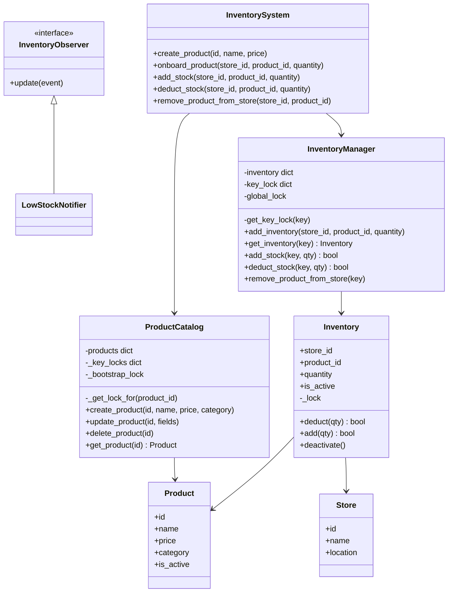
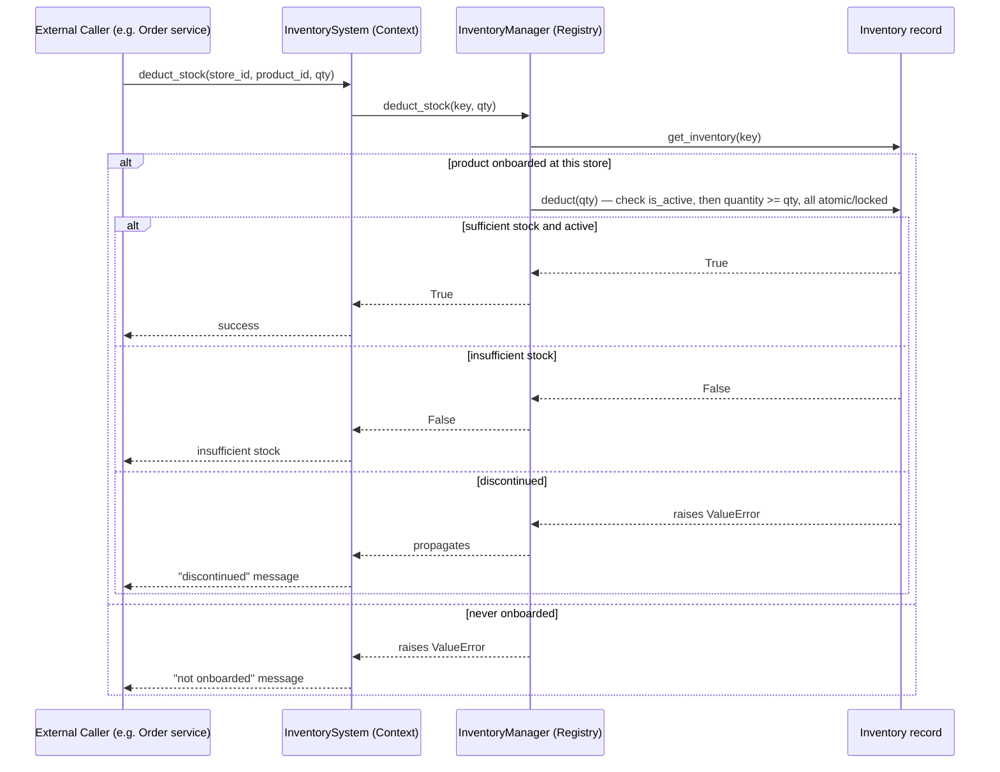
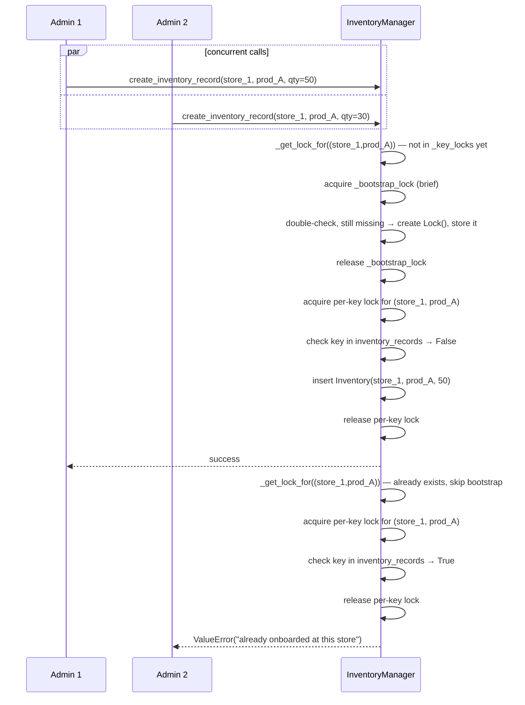

# Inventory Management System — Implementation Plan

(Filled from `framework/implementation-template.md`. Concepts referenced here are explained in `learning.md` — read that first if any of this feels unfamiliar.)

---

## 1. Requirement

**This is the authoritative spec** (see `learning.md` §1 for the full discussion — this section stays in sync with it).

**Functional**
- Manage millions of products.
- Create, update products *inside a store* (per-store inventory onboarding + stock changes).
- Each store is managed by an inventory management system (see the open question below).
- Low-stock alerts.

**Explicitly out of scope**
- Stock transfer between stores/warehouses.
- Check availability — given a product and quantity, return which warehouses can fulfill it (no cross-store query/routing).
- Ordering/checkout itself (`Order`, cart, payment) — belongs to a hypothetical external Order/Checkout service that would call this system's plain create/update/deduct API. See `learning.md` §6.
- **Reservation / hold-with-expiry (reserve→confirm→release)** — considered and deliberately dropped to keep this build simple and tightly matched to the spec above, which never asks for cart/checkout-style holds. Stock changes are immediate (`deduct_stock`/`add_stock`). Kept as a one-paragraph follow-up answer in `learning.md` §5 if asked "what about a gap between claim and commit."

**Non-functional**
- Thread safety under concurrent operations — the requirement this whole build has centered on.

**Open design question, stated explicitly rather than silently assumed**: "each store is managed by an inventory management system" could mean (a) one centralized `InventoryManager` across all stores, keyed by `(store_id, product_id)` — **this is what's built**, or (b) a separate `InventoryManager` instance per store, keyed by `product_id` alone. Both are defensible; worth raising with an interviewer rather than picking silently.

**Clarifying questions (assumed answers for this build)**
1. In-memory to start, distributed discussed but not built → *assumed: in-memory, discuss distributed as extension; "millions of products" makes the lock-striping follow-up (`learning.md` §12) a real consideration, not just a footnote.*
2. Centralized `InventoryManager` vs. one per store → *assumed: centralized, per the open question above — flag this as a choice, not a given.*
3. Is soft-delete (discontinuing a product at a store) required, or is create/update sufficient? *Already built either way.*

---

## 2. Core Entities

| Entity | Responsibility |
|---|---|
| `Product` | Catalog data — id, name, price, category, `is_active`. Read-heavy, store-independent. |
| `ProductCatalog` | Manager — CRUD over `Product` (create/update/soft-delete), keyed by `product_id`. Explicit create, not lazy. |
| `Store` | Identity + location, used for store selection. |
| `Inventory` | One record per `(store_id, product_id)` — stock quantity, `is_active`, the actual concurrency-controlled resource. |
| `InventoryManager` | Registry — owns all `Inventory` records, keyed by `(store_id, product_id)`, created **explicitly** (not lazily — see §6 note below). Also owns update/remove logic (routing to the right record). |
| `InventoryObserver` | Notified on low-stock events — a required feature per §1, not optional. |
| `InventorySystem` | Context — the single public entry point: `create_product`, `onboard_product`, `add_stock`, `deduct_stock`, `remove_product_from_store`. No `place_order`, no reservation primitives — both out of scope (§1). |

`Order`/`OrderItem`/`StoreSelectionStrategy`/`Reservation` dropped from this table — all out of scope per §1.

**Design correction from first pass**: `InventoryManager` originally used a `get_or_create` (borrowed from `RateLimiterRegistry`'s lazy-creation shape). That doesn't fit here — "does this store carry this product" is a deliberate business fact, not something to silently fabricate on first access. Creation is now an explicit `create_inventory_record` call; lookup (`get_inventory`) returns `None` if not found instead of auto-creating, so an order against a product a store never onboarded fails cleanly rather than conjuring a phantom zero-stock record.

**Framework decision table**

| Question | Answer | Pattern |
|---|---|---|
| Manages a keyed collection of records? | `Inventory`/`Product` records per key | **Manager** (Registry-shaped, same as `RateLimiterRegistry`) |
| Notify other objects on change? | Low stock (required, §1) | **Observer** |
| Single public entry point? | `InventorySystem` | **Context** |

**No State** (order lifecycle out of scope) and **no Strategy** (store selection needs cross-store availability logic, out of scope) for this spec — a smaller, more focused pattern set than an earlier, broader exploration of this problem used. No Builder/Decorator/Chain of Responsibility/Visitor needed either — don't force patterns the scoped-down problem doesn't call for.

---

## 3. Class Diagram



**Two lock granularities, not one** — worth calling out explicitly since it's easy to miss:
- **Create path** — `InventoryManager`/`ProductCatalog` each keep a `key_lock` dict (one lock per key — `(store_id, product_id)` / `product_id`) plus a single `global_lock` used only to safely create a *new* per-key lock the first time a key is touched (double-checked locking — see `learning.md` §12). Two creates on the *same* key contend; different keys — even different products in the *same* store — never block each other. Not a single global lock.
- **Update path** — `Inventory._lock`, one per *existing* record, guards every mutation on that specific record (`deduct`, `add`, `deactivate`). Already inherently per-record since each `Inventory` instance owns its own lock — this is the hot path (called on every stock update), so per-record granularity matters even more here than on the create path.

Note `ProductCatalog.update_product`/`delete_product` are shown in its class block above as **designed but not yet implemented in code** — `create_product`/`get_product` are the only ones actually built so far.

**Concurrency behavior matrix** (same shape applies to both the create path and the update path — only the lock object differs):

| Scenario | Result |
|---|---|
| Same store, same product, concurrent | Contend on the same lock — serialized correctly (second create gets a clean "already exists" error; second update runs after the first completes). |
| Same store, different products, concurrent | Different keys → different locks → **fully parallel**. |
| Different stores, concurrent (same or different product id) | Key includes `store_id`, so always different locks → **fully parallel**. |

---

## 4. Flow Diagram — Deduct Stock (the core use case)

Note the actor here is a generic **external caller** — a hypothetical Order/Checkout service, not something this system models. This system only exposes a direct, immediate stock update; it has no opinion on carts, payment, or purchase status (see `learning.md` §5 for why reserve/confirm/release was considered and dropped).



### 4b. Flow Diagram — Concurrent Product Onboarding (per-key lock, not a global one)

Two admins racing to onboard the **same** product at the **same** store — the race is on the dict, not on any `Inventory` object (it doesn't exist yet). Note `_bootstrap_lock` is only ever held for the instant it takes to create a `Lock()` object — the actual check-then-insert happens under the per-key lock:



Whichever call acquires the per-key lock first wins cleanly; the second sees the key already present and gets a proper error instead of silently overwriting the first admin's record. A concurrent `create_inventory_record(store_2, prod_B, ...)` from a third admin would resolve to a completely different per-key lock and proceed in parallel with both of the above, undelayed.

---

## 5. Implementation

**Folder layout** (matching `rate-limiter/` and `parking-lot/` convention):
```
inventory-management-system/
  models/
    product.py
    store.py
    inventory.py
  observer/
    inventory_observer.py         (interface)
    low_stock_notifier.py
  manager/
    product_catalog.py
    inventory_manager.py
  inventory_system.py             (top-level Context)
  main.py                         (demo)
```
`states/`, `strategy/`, `order.py`/`order_item.py`, and `reservation.py` all dropped — order lifecycle, store selection, and reserve/confirm/release holds are all out of scope (§1).

**Build order, reflecting actual progress this session (update as we go):**
1. ✅ `Inventory` model — `deduct`/`add`/`deactivate`, guarded by its own per-record `_lock`. This is the final shape (no reservation upgrade planned — see §1).
2. ✅ `InventoryManager` — explicit `add_inventory` (per-key lock, double-checked bootstrap, `learning.md` §12) + `get_inventory` (no auto-create) + `add_stock`/`deduct_stock`/`remove_product_from_store`, keyed by `(store_id, product_id)`.
3. 🟡 `ProductCatalog` — `create_product`/`get_product` built; **`update_product`/`delete_product` designed early on but never implemented — concrete gap, worth closing given §1 explicitly says "update products."**
4. ⬜ `InventoryObserver` + `LowStockNotifier` — not started. Now a **required** feature per §1 — the single biggest remaining gap.
5. ✅ `InventorySystem` — thin Context exposing `create_product`/`onboard_product`/`add_stock`/`deduct_stock`/`remove_product_from_store`. `place_order` and its `models/order.py` dependency have been removed.
6. ✅ `main.py` — demo covers the full CRUD flow (create/onboard/deduct/insufficient-stock/duplicate-onboard/not-onboarded/restock/soft-delete) plus a concurrency proof for `deduct_stock` (5 threads racing on one record, no overselling).

**Progress tracking:**
- [x] Inventory model + record-level concurrency control (deduct/add/deactivate)
- [x] InventoryManager + per-key create-path concurrency control
- [x] ProductCatalog create/read — [ ] update/delete still unbuilt (designed, not coded)
- [ ] Low-stock observer — **not started, now required**
- [x] InventorySystem context (place_order removed)
- [x] main.py demo (including concurrency proof)

---

## 6. Think About Extensibility

- **Scale to distributed/multi-server, or to "millions of products" (§1)** → `InventoryManager`'s in-memory dict + `threading.Lock` stop being sufficient. Swap to: DB-backed `Inventory` rows with `UPDATE ... WHERE available >= qty` for the atomic check-and-decrement (see `learning.md` §4/§7), keeping the same `InventoryManager` interface — callers don't know or care that the storage moved from a dict to a database. At millions-of-keys scale, also revisit the per-key `Lock()`-per-key approach in favor of **lock striping** (`learning.md` §12) — unbounded lock objects stop being a footnote at this scale.
- **New low-stock side effect** (e.g. auto-trigger a supplier reorder in addition to notifying ops) → new `InventoryObserver` subclass only; `Inventory`/`InventoryManager` untouched.
- **New CRUD field/operation on `Product` or `Inventory`** (e.g. a `discount_percentage` field, or a `pause_sales` toggle) → just guarded by the existing per-record `_lock`; the two-lock-granularity shape (registry lock for create, record lock for everything else) doesn't need to change to absorb it.
- **Hard delete instead of soft delete** — only reasonable if you're certain nothing references the record historically; otherwise soft delete (`is_active = False`) stays the safer default, since it preserves the audit trail without changing any lookup code (`deduct` already checks `is_active`).

**Explicitly out of scope (§1) — but worth a one-paragraph answer each if asked:**
- **Stock transfer between stores** → conceptually a deduct on the source `Inventory` record + an add on the destination record, atomically. This is exactly the multi-resource-atomicity problem discussed for multi-item orders: acquire both records' locks in one canonical order (e.g. sort by `(store_id, product_id)`) to avoid deadlock against a concurrent transfer going the opposite direction, validate both sides, then commit both.
- **Cross-store availability check** ("given a product and quantity, which warehouses can fulfill it") → would be a read-only scan over all `Inventory` records for a given `product_id` across stores, filtering by `quantity >= qty` and `is_active`. No locking concern (pure read), but at "millions of products" scale, this needs an index by `product_id` rather than a linear scan of the whole registry — a genuine reason to move this off an in-memory dict onto a real datastore with a secondary index.
- **Ordering/checkout** → a separate service, consuming this system's plain create/update/deduct API. See `learning.md` §6 for the full reasoning.
- **Reserve/confirm/release with TTL-based holds** → considered and dropped to stay simple; see `learning.md` §5 for the one-paragraph version of how it would work if a cart/checkout flow needed it.
