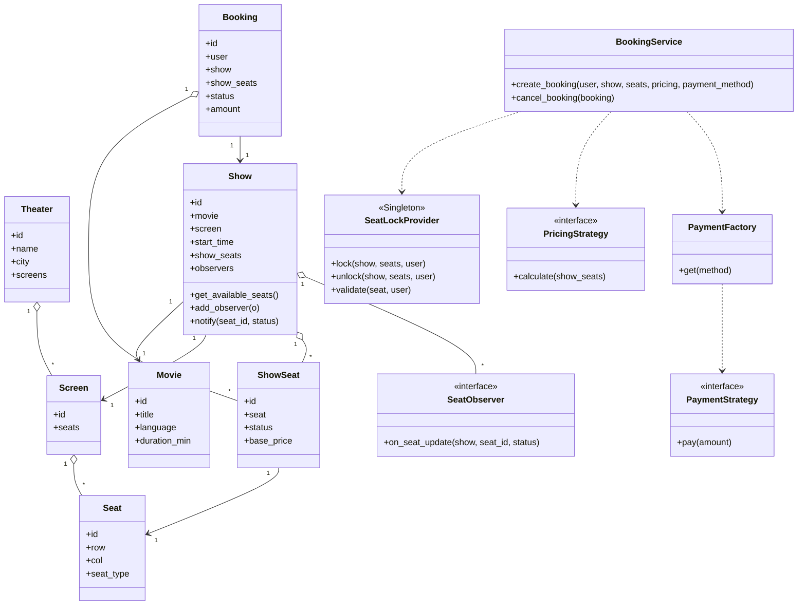

# Movie Ticket Booking (BookMyShow-style) — LLD

> A consolidated, rehearse-the-night-before design doc. Read top-to-bottom once, then close it and try to rebuild §4 and §5 from memory — that's the practice loop.

---

## 1. Understanding the Problem

We're designing the backend object model for a movie-ticket platform: a user picks a city and date, sees which movies are playing, drills into a specific **show** (a movie on a specific screen at a specific time), sees a seat map, selects seats, pays, and gets a confirmed booking — or cancels later.

The one thing that makes this non-trivial — and the *only* thing an interviewer is really probing — is **concurrent seat booking**. Two users looking at the same show will both see seat `A5` as available at the same instant. The entire design lives or dies on whether exactly **one** of them can end up owning that seat. Everything else (search, entities, pricing) is scaffolding around that single race condition. Name this out loud in the interview immediately; it's the checkpoint.

---

## 2. Requirements

### Clarifying Questions

**Candidate:** What are the core actions a user can take? Just browse-and-book, or also cancel?
**Interviewer:** Search movies by city and date, view seats for a show, select + book + pay, and cancel an existing booking. All four.

**Candidate:** When two people grab the same seat at the same time, what's the expected behavior?
**Interviewer:** Exactly one succeeds. The other must be cleanly rejected — never a double-booking. This is the part I care most about.

**Candidate:** Payment is presumably external and can fail or be slow. Do we hold the seat while the user pays?
**Interviewer:** Yes — hold it temporarily so someone else can't take it mid-payment, but the hold must expire if they abandon checkout. Don't leak locked seats forever.

**Candidate:** Do seats have different prices, and are discounts in scope?
**Interviewer:** Yes, seat types have different base prices, and I want pricing/discounts to be pluggable — assume promos will get added later.

**Candidate:** Should availability update in near real-time for people already staring at the seat map?
**Interviewer:** Ideally yes — if a seat gets booked, viewers of that show should be notified. Model it; don't build the websocket layer.

**Candidate:** Out of scope — real payment gateways, auth, seat recommendations, refunds math?
**Interviewer:** Correct, all out of scope. Assume payment is a mockable interface and users already exist.

### Final Requirements

**Functional**
- Search movies by **city** and **date**.
- For a selected movie, list its **shows** (screen + time) and view the **seat map** with per-seat availability and price.
- **Select → lock → pay → confirm** a set of seats into a single **Booking**.
- **Cancel** a confirmed booking (frees the seats).
- **Pluggable pricing/discount** computation per booking.

**Non-Functional**
- **No double-booking** under concurrency — the hard invariant.
- Temporary seat **hold with expiry** during checkout (no permanently-leaked locks).
- **Near real-time availability** — observers of a show are notified on seat state changes.
- Extensible pricing and payment (add strategies without touching booking logic).

**Out of Scope**
- Real payment-gateway integration (mock interface only).
- Authentication / user management (users pre-exist).
- Refund/settlement accounting, seat recommendations, dynamic surge pricing.
- Persistence/DB layer — we model in-memory; the concurrency reasoning is what transfers.

---

## 3. Core Entities and Relationships

Walk the nouns and interrogate each one — *does it have behavior, or is it a field on something else?*

- **Movie** — real entity. Title, language, duration. Referenced by many shows.
- **City** — barely an entity. It's a filter key on Theater. Model it as a simple field/string, not a class with behavior. *(cut)*
- **Theater / Cinema** — real. Belongs to a city, owns screens.
- **Screen (Auditorium)** — real. Owns a fixed physical seat layout. A show happens *on* a screen.
- **Seat** — the **physical** seat (row/number/type). Static — it never changes state. Belongs to a Screen.
- **ShowSeat** — the key insight: the *bookable unit* is not `Seat`, it's `Seat × Show`. `A5` is available for the 6pm show and booked for the 9pm show simultaneously. **State (available/locked/booked) and price live here, not on Seat.** This separation is the single most common thing juniors miss.
- **Show** — real. Movie + Screen + time window. Owns its collection of `ShowSeat`s. This is also the natural **Subject** for the Observer pattern.
- **Booking** — real. The user's transaction: which ShowSeats, which user, status, amount.
- **User** — pre-exists; treat as a thin id/name holder.
- **Payment** — behavior via a Strategy, created by a Factory. Not a rich entity.
- **SeatLockProvider** — not a domain noun, but the **concurrency workhorse**. Owns the hold-with-expiry logic. Singleton.

| Entity | Responsibility |
|---|---|
| `Movie` | Immutable movie metadata (title, language, duration). |
| `Theater` | Groups screens within a city. |
| `Screen` | Owns the physical seat layout for one auditorium. |
| `Seat` | Physical seat identity + type (REGULAR/PREMIUM/RECLINER). Stateless. |
| `Show` | Movie on a Screen at a time; owns `ShowSeat`s; is the Observer **Subject**. |
| `ShowSeat` | Bookable unit: status + price for one seat in one show. |
| `Booking` | A user's set of ShowSeats + status + total amount. |
| `User` | Thin identity holder (pre-exists). |
| `SeatLockProvider` | Acquires/releases seat holds with TTL; enforces single-owner. **Singleton.** |
| `PricingStrategy` | Computes booking total (Strategy). |
| `PaymentStrategy` | Executes a mock payment (Strategy, built by Factory). |
| `BookingService` | Orchestrates lock → pay → confirm / cancel. |
| `SearchService` | City+date → movies → shows. |

---

## 4. Class Design

### `Seat` vs `ShowSeat` (the decision that carries the whole design)

- `Seat`: `id, row, col, seat_type` — pure data, no methods worth naming. **No behavior → no interface, no subclasses per seat type.** Seat type is an *enum field*, not a class hierarchy; there is no polymorphic behavior on a seat, only a price lookup keyed by type. Making `PremiumSeat(Seat)` would be indirection with zero payoff.
- `ShowSeat`: `id, seat, show, status: SeatStatus, base_price`. This holds the mutable state the whole system contends over.

| Requirement | Tracked via |
|---|---|
| Same physical seat bookable per show | `ShowSeat = Seat × Show`, status lives on `ShowSeat` not `Seat` |
| No double-booking | `ShowSeat.status ∈ {AVAILABLE, LOCKED, BOOKED}` + external lock |
| Per-seat-type pricing | `Seat.seat_type` → `ShowSeat.base_price` |
| Near real-time availability | status transitions fire `Show.notify_observers()` |

### `Show` — the Observer Subject

State: `id, movie, screen, start_time, show_seats: dict[seat_id → ShowSeat], observers: list`.
Methods: `get_available_seats()`, `add_observer(o)`, `notify(seat_id, new_status)`.

**Anti-pattern check:** Observer here is *justified* — there are genuinely N independent watchers (each viewing client) that must react to a state change they don't own. That's real fan-out, not one hardcoded callback. Keep it.

### `SeatLockProvider` — Singleton

State: `locks: dict[showseat_id → SeatLock(user, expiry)]`, one `Lock` (mutex).
Methods: `lock(show, seats, user)`, `unlock(show, seats, user)`, `validate(seat, user)`, `_is_expired(seat)`.

**Anti-pattern check:** Singleton is justified *only because* every booking attempt in the process must contend against the **same** lock table — two provider instances would each think a seat is free and we'd be back to double-booking. That shared-single-source-of-truth requirement is exactly what Singleton is for. (In a real distributed system this becomes Redis `SETNX` with TTL — same idea, externalized. Say this in the interview.)

#### Good Solution vs. Great Solution — how the hold expires

- **Good:** a background sweeper thread scans the lock table every second and evicts expired locks.
  - *Breaks:* extra thread, timer complexity, and a window where an expired-but-not-yet-swept lock still blocks a new buyer. Wasteful for the common case.
- **Great:** **lazy expiry** — never sweep. When a new buyer tries to lock a seat, *if the existing lock is already past its expiry, treat it as free and overwrite it.* Expiry is evaluated at the only moment it matters: contention time.
  - *Why it wins:* no background thread, no eviction lag, correctness checked exactly when someone actually wants the seat. (This is the same reason rate-limiters lazy-expire buckets.)

### Pricing & Payment — Strategy + Factory

- `PricingStrategy.calculate(show_seats) -> amount`; concrete: `BasePricing`, `WeekendPricing`, `DiscountPricing(pct)`.
- `PaymentStrategy.pay(amount) -> bool`; concrete: `CreditCardPayment`, `UpiPayment`.
- `PaymentFactory.get(method) -> PaymentStrategy` — **Factory** so `BookingService` never `new`s a concrete payment class; add UPI/wallet without editing booking code.

**Anti-pattern check:** Strategy earns its place *only* because the spec explicitly says pricing/discounts are pluggable and more will be added — genuine variation. If the interviewer said "flat price, forever," a single `calculate()` function would be the honest answer and a Strategy interface would be over-engineering. Gate the pattern on the stated requirement, not on wanting to show off patterns.

### Class Diagram



---

## 5. Implementation

Two hard parts, per §1: **(A) double-booking prevention** (the whole ballgame) and, briefly, **(B) the booking orchestration** that uses it.

### Part A — Preventing double-booking

#### Bad — check-then-set on the status flag

```python
def book(show, seat_ids, user):
    for sid in seat_ids:
        ss = show.show_seats[sid]
        if ss.status == SeatStatus.AVAILABLE:   # CHECK
            ss.status = SeatStatus.BOOKED        # ...SET
        else:
            raise SeatUnavailable(sid)
```
- *Approach:* read the flag, write the flag.
- *Challenges:* the check and the set are **two separate steps**. Thread T1 and T2 both read `AVAILABLE` before either writes. Both proceed. Both "succeed."
- *Tradeoffs:* dead simple, and **wrong** — this is the textbook TOCTOU (time-of-check to time-of-use) race. It *looks* correct in single-threaded testing, which is why it's dangerous. Reject it out loud.

#### Good — one global lock around the whole booking

```python
_global = threading.Lock()
def book(show, seat_ids, user):
    with _global:                      # serialize ALL bookings, everywhere
        for sid in seat_ids:
            if show.show_seats[sid].status != SeatStatus.AVAILABLE:
                raise SeatUnavailable(sid)
        for sid in seat_ids:
            show.show_seats[sid].status = SeatStatus.BOOKED
```
- *Approach:* make check-and-set atomic by letting only one booking run at a time.
- *Challenges:* correct, but the lock is held *across the whole booking* — and a booking includes **payment**, which is slow/external. While one user enters their card, every other user of *every other show in the entire system* is blocked.
- *Tradeoffs:* correctness ✅, concurrency ❌. Coarse lock = a global bottleneck. Also doesn't model the "hold seat during payment, expire if abandoned" requirement at all.

#### Great — seat-level hold (lock) with lazy TTL expiry, released before payment blocks others

```python
# Acquire a short-lived HOLD on exactly the requested seats, atomically.
# Payment happens AFTER we hold, so slow payment blocks nobody else's seats.
def create_booking(user, show, seat_ids, pricing, payment_method):
    lock_provider.lock(show, seat_ids, user)      # atomic, per-seat, TTL hold
    try:
        amount = pricing.calculate([show.show_seats[s] for s in seat_ids])
        ok = PaymentFactory.get(payment_method).pay(amount)   # slow — but only OUR seats are held
        if not ok:
            raise PaymentFailed()
        for s in seat_ids:
            show.show_seats[s].status = SeatStatus.BOOKED
            show.notify(s, SeatStatus.BOOKED)     # Observer fan-out
        return Booking(user, show, seat_ids, amount, BookingStatus.CONFIRMED)
    finally:
        lock_provider.unlock(show, seat_ids, user)  # release hold (booked seats stay booked)
```
- *Approach:* the *mutex* is held only for the microseconds it takes to claim the seats; the *business hold* is a per-seat lock record with an expiry. Payment runs while we merely hold — contention window shrinks from "duration of payment" to "duration of a dict write."
- *Tradeoffs:* more moving parts (lock table, expiry), but it's the only design that satisfies **all three** of: no double-booking, no global bottleneck, and hold-with-expiry.

**Why lazy expiry, not a sweeper?** See §4 — evaluate expiry at contention time only; no background thread, no eviction lag.

**Why lock the seats, not the Show?** Locking the whole Show serializes independent buyers picking *different* seats in the same popular show — pure contention for no reason. Seat-level granularity lets `A5` and `B7` buyers proceed in parallel.

### The lock provider (the atomic core)

```python
class SeatLockProvider:              # Singleton
    def lock(self, show, seat_ids, user, ttl=300):
        with self._mutex:                       # only the claim is serialized
            # Phase 1: validate ALL seats are free (or hold expired) — check nothing partial
            for sid in seat_ids:
                existing = self._locks.get((show.id, sid))
                seat = show.show_seats[sid]
                if seat.status == SeatStatus.BOOKED:
                    raise SeatUnavailable(sid)
                if existing and not self._expired(existing) and existing.user != user:
                    raise SeatUnavailable(sid)   # someone else holds a live lock
            # Phase 2: only now, having validated all, claim all
            for sid in seat_ids:
                self._locks[(show.id, sid)] = SeatLock(user, self._now() + ttl)
                show.show_seats[sid].status = SeatStatus.LOCKED
                show.notify(sid, SeatStatus.LOCKED)
```

Note the **two-phase** structure: validate *every* seat before mutating *any*. Without it, a 3-seat request could claim seats 1–2, fail on seat 3, and leave a partial hold — the caller thinks it failed but two seats are now stuck.

### Verification trace — two threads race for seat `A5`

Show `S` has `A5` = AVAILABLE. T1 (Alice) and T2 (Bob) both call `create_booking(..., ["A5"], ...)`.

| Step | Thread | Action | `_mutex` | `A5` status | `_locks[A5]` |
|---|---|---|---|---|---|
| 1 | T1 | enters `lock()`, acquires `_mutex` | held by T1 | AVAILABLE | — |
| 2 | T2 | enters `lock()`, **blocks** on `_mutex` | held by T1 | AVAILABLE | — |
| 3 | T1 | validate: A5 free ✅ → claim | held by T1 | LOCKED | Alice, exp=t+300 |
| 4 | T1 | releases `_mutex`, proceeds to pay | free | LOCKED | Alice |
| 5 | T2 | **unblocks**, acquires `_mutex` | held by T2 | LOCKED | Alice |
| 6 | T2 | validate: A5 lock exists, not expired, owner≠Bob → **raise SeatUnavailable** | held by T2 | LOCKED | Alice |
| 7 | T2 | releases `_mutex`, booking fails cleanly | free | LOCKED | Alice |
| 8 | T1 | payment OK → status=BOOKED, notify observers | free | BOOKED | (unlocked) |

Exactly one owner. T2 fails *fast* (no payment attempted) and *cleanly* (no partial state). The mutex was held only across steps 3 and 6 — microseconds — never across payment. ✅

**Expiry trace:** if Alice abandons checkout, at t+300 her lock is stale. Bob retries at t+301 → step 6 now sees `_expired(existing) == True` → treats A5 as free → claims it. No sweeper ran. ✅

### Complete Code

```python
import threading
from enum import Enum
from itertools import count


# ---------- enums ----------
class SeatStatus(Enum):
    AVAILABLE = "AVAILABLE"
    LOCKED = "LOCKED"
    BOOKED = "BOOKED"


class SeatType(Enum):
    REGULAR = "REGULAR"
    PREMIUM = "PREMIUM"
    RECLINER = "RECLINER"


class BookingStatus(Enum):
    CONFIRMED = "CONFIRMED"
    CANCELLED = "CANCELLED"


# ---------- exceptions ----------
class SeatUnavailable(Exception):
    pass


class PaymentFailed(Exception):
    pass


# ---------- data entities ----------
class Movie:
    def __init__(self, id, title, language, duration_min):
        self.id, self.title, self.language, self.duration_min = id, title, language, duration_min


class Seat:
    def __init__(self, id, row, col, seat_type):
        self.id, self.row, self.col, self.seat_type = id, row, col, seat_type


class Screen:
    def __init__(self, id, seats):
        self.id, self.seats = id, seats


class Theater:
    def __init__(self, id, name, city, screens):
        self.id, self.name, self.city, self.screens = id, name, city, screens


class ShowSeat:
    _ids = count(1)
    BASE_PRICE = {SeatType.REGULAR: 150, SeatType.PREMIUM: 250, SeatType.RECLINER: 400}

    def __init__(self, seat):
        self.id = seat.id
        self.seat = seat
        self.status = SeatStatus.AVAILABLE
        self.base_price = self.BASE_PRICE[seat.seat_type]


# ---------- observer ----------
class SeatObserver:
    def on_seat_update(self, show, seat_id, status):
        raise NotImplementedError


class ConsoleSeatObserver(SeatObserver):
    def __init__(self, name):
        self.name = name

    def on_seat_update(self, show, seat_id, status):
        print(f"[{self.name}] show {show.id}: seat {seat_id} -> {status.value}")


class Show:
    def __init__(self, id, movie, screen, start_time):
        self.id, self.movie, self.screen, self.start_time = id, movie, screen, start_time
        self.show_seats = {s.id: ShowSeat(s) for s in screen.seats}
        self._observers = []

    def add_observer(self, o):
        self._observers.append(o)

    def notify(self, seat_id, status):
        for o in self._observers:
            o.on_seat_update(self, seat_id, status)

    def get_available_seats(self):
        return [ss for ss in self.show_seats.values() if ss.status == SeatStatus.AVAILABLE]


class Booking:
    _ids = count(1)

    def __init__(self, user, show, seat_ids, amount, status):
        self.id = next(self._ids)
        self.user, self.show, self.seat_ids = user, show, seat_ids
        self.amount, self.status = amount, status


# ---------- strategy: pricing ----------
class PricingStrategy:
    def calculate(self, show_seats):
        raise NotImplementedError


class BasePricing(PricingStrategy):
    def calculate(self, show_seats):
        return sum(ss.base_price for ss in show_seats)


class DiscountPricing(PricingStrategy):
    def __init__(self, pct):
        self.pct = pct

    def calculate(self, show_seats):
        return sum(ss.base_price for ss in show_seats) * (1 - self.pct / 100)


# ---------- strategy + factory: payment ----------
class PaymentStrategy:
    def pay(self, amount):
        raise NotImplementedError


class CreditCardPayment(PaymentStrategy):
    def pay(self, amount):
        return True  # mock success


class UpiPayment(PaymentStrategy):
    def pay(self, amount):
        return True


class PaymentFactory:
    _registry = {"card": CreditCardPayment, "upi": UpiPayment}

    @classmethod
    def get(cls, method):
        strategy_cls = cls._registry.get(method)
        if not strategy_cls:
            raise ValueError(f"Unknown payment method: {method}")
        return strategy_cls()


# ---------- singleton: seat lock provider ----------
class SeatLock:
    def __init__(self, user, expiry):
        self.user, self.expiry = user, expiry


class SeatLockProvider:
    _instance = None
    _instance_lock = threading.Lock()

    def __new__(cls):
        # double-checked locking so even the Singleton creation is thread-safe
        if cls._instance is None:
            with cls._instance_lock:
                if cls._instance is None:
                    inst = super().__new__(cls)
                    inst._mutex = threading.Lock()
                    inst._locks = {}          # (show_id, seat_id) -> SeatLock
                    inst._clock = [0]         # injectable logical clock for tests
                    cls._instance = inst
        return cls._instance

    def _now(self):
        return self._clock[0]

    def _expired(self, lock):
        return self._now() >= lock.expiry

    def lock(self, show, seat_ids, user, ttl=300):
        with self._mutex:
            # phase 1: validate ALL before mutating ANY
            for sid in seat_ids:
                seat = show.show_seats[sid]
                if seat.status == SeatStatus.BOOKED:
                    raise SeatUnavailable(sid)
                existing = self._locks.get((show.id, sid))
                if existing and not self._expired(existing) and existing.user != user:
                    raise SeatUnavailable(sid)
            # phase 2: claim all
            for sid in seat_ids:
                self._locks[(show.id, sid)] = SeatLock(user, self._now() + ttl)
                show.show_seats[sid].status = SeatStatus.LOCKED
                show.notify(sid, SeatStatus.LOCKED)

    def unlock(self, show, seat_ids, user):
        with self._mutex:
            for sid in seat_ids:
                existing = self._locks.get((show.id, sid))
                if existing and existing.user == user:
                    del self._locks[(show.id, sid)]

    def validate(self, show, seat_id, user):
        existing = self._locks.get((show.id, seat_id))
        return bool(existing) and existing.user == user and not self._expired(existing)


# ---------- services ----------
class BookingService:
    def __init__(self):
        self.locks = SeatLockProvider()

    def create_booking(self, user, show, seat_ids, pricing, payment_method):
        self.locks.lock(show, seat_ids, user)          # atomic hold
        try:
            seats = [show.show_seats[s] for s in seat_ids]
            amount = pricing.calculate(seats)
            if not PaymentFactory.get(payment_method).pay(amount):
                raise PaymentFailed()
            for s in seat_ids:                          # commit
                if not self.locks.validate(show, s, user):
                    raise SeatUnavailable(s)            # our hold expired mid-payment
                show.show_seats[s].status = SeatStatus.BOOKED
                show.notify(s, SeatStatus.BOOKED)
            return Booking(user, show, seat_ids, amount, BookingStatus.CONFIRMED)
        finally:
            self.locks.unlock(show, seat_ids, user)     # booked seats already flipped; frees any residual hold

    def cancel_booking(self, booking):
        for s in booking.seat_ids:
            booking.show.show_seats[s].status = SeatStatus.AVAILABLE
            booking.show.notify(s, SeatStatus.AVAILABLE)
        booking.status = BookingStatus.CANCELLED


class SearchService:
    def __init__(self, theaters, shows):
        self.theaters, self.shows = theaters, shows

    def search(self, city, date):
        city_theaters = {t.id for t in self.theaters if t.city == city}
        return [sh for sh in self.shows
                if sh.screen.id in {sc.id for t in self.theaters if t.id in city_theaters for sc in t.screens}
                and sh.start_time.date() == date]
```

---

## 6. Extensibility

- **Distributed / multi-server deployment (Senior).** The in-process `SeatLockProvider` mutex no longer works once bookings hit multiple app servers. What changes: the lock table moves to Redis (`SET seatkey user NX PX 300000` — atomic set-if-absent with TTL gives us the exact same "one owner + lazy expiry" semantics for free). What stays: `BookingService`, the two-phase claim, the Strategy/Factory/Observer wiring — all untouched. Only the provider's guts swap.

- **Real payment gateway with pending/webhook flow (Senior).** Payment stops being synchronous `pay() -> bool`. Booking gets a `PENDING` status; a webhook later confirms or fails. What changes: `BookingStatus` gains `PENDING/FAILED`; the hold TTL must outlive the gateway round-trip. What stays: the Strategy interface (`pay()` returns a pending-handle instead of a bool), and the seat-hold model — the hold is *why* async payment is even safe.

- **Group booking / seat-adjacency rules (Mid+).** "5 seats together." What changes: a `SeatSelectionStrategy` that, given the seat map, returns contiguous blocks — another clean Strategy drop-in. What stays: everything downstream of seat selection; the locker doesn't care how the seat list was chosen.

- **Real-time push to browsers (Mid+).** Today `notify()` calls in-process observers. What changes: add a `WebSocketObserver` that pushes to a client; register it per viewing session. What stays: `Show` as Subject and the entire `notify()` call-site graph — this is exactly the extension Observer was chosen to enable.

---

## 7. What's Expected at Each Level

**Junior**
- Gets the entity list roughly right, but often puts `status` on `Seat` instead of discovering `ShowSeat` — the interviewer will nudge here.
- Implements the naive check-then-set and, when asked "what if two users click at once?", recognizes there's *a* problem even if the fix is shaky.
- Uses patterns because they were named, without gating them on need.

**Mid-level**
- Separates `Seat` from `ShowSeat` unprompted; justifies it in one sentence.
- Reaches a per-show or global lock and correctly identifies the double-booking race; implements a working (if coarse) fix.
- Applies Strategy/Factory/Observer *and* can say why each is justified vs. over-engineering; handles cancel and basic pricing.

**Senior**
- Goes straight to **seat-level hold with lazy TTL expiry**, holds the mutex only across the claim (not payment), and explains the two-phase validate-then-claim to avoid partial holds.
- Volunteers the distributed follow-up (Redis `SETNX PX`) and the async-payment implication on hold lifetime — unprompted.
- Continuously prunes: names at least one pattern they *chose not to* add and why (e.g. no seat subclasses), showing taste, not just knowledge.

---

### Practice loop
1. Cover §4–§5. From the requirements alone, redraw the class diagram and name why `ShowSeat` exists.
2. Write the Bad → Good → Great locking progression from scratch; then check your `_mutex`-scope against the trace table.
3. Explain the lazy-expiry choice and the distributed follow-up out loud in under 90 seconds.
