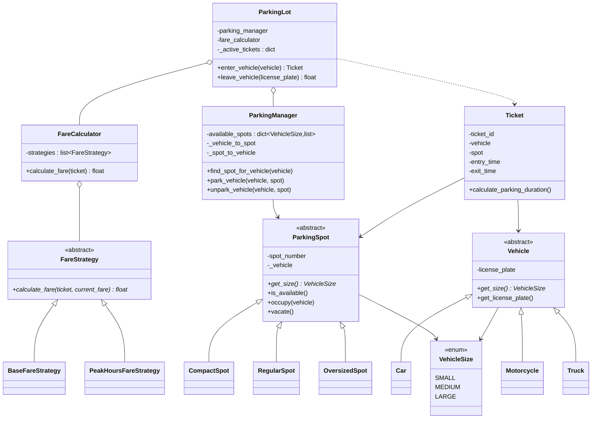

# Parking Lot — LLD

> A consolidated, rehearse-the-night-before design doc. Read top-to-bottom once, then close it and try to rebuild §4 and §5 from memory — that's the practice loop. This doc documents the code that actually lives in this folder; where the built code takes a shortcut on purpose, it's marked ⬜.

---

## 1. Understanding the Problem

We're designing the object model for a parking lot: vehicles of different sizes drive in, we find them a spot that fits, hand them a ticket, and when they leave we compute a fare from how long they stayed. The lot has spots of different sizes, and a vehicle can only use a spot its size fits into.

The one thing that makes this non-trivial — and the part an interviewer is really probing — is **keeping "find an available spot" O(1) as the lot fills up, while keeping the fee logic open to new pricing rules without rewriting the checkout path.** Anyone can scan a list of spots; the design question is what data structure makes assignment cheap, and how pricing stays pluggable (base rate today, peak-hour surge tomorrow, weekend/EV/discount after that) without the `leave_vehicle` method growing an `if` for every rule. Name both out loud early: *spot lookup by size class* and *pricing as a composable chain*.

---

## 2. Requirements

### Clarifying Questions

**Candidate:** What actions does the lot need to support — just park and unpark, or also queries like "where is my car"?
**Interviewer:** Park a vehicle (assign a spot, issue a ticket), and unpark it (free the spot, charge a fare). A reverse lookup — vehicle→spot and spot→vehicle — is nice to have.

**Candidate:** Do different vehicles need different spots?
**Interviewer:** Yes. Think three size classes — motorcycle, car, truck — and correspondingly sized spots. A vehicle takes a spot of its own size class.

**Candidate:** If a truck comes in and there's no truck-sized spot, can it take a smaller or larger one?
**Interviewer:** For this session, keep it strict — a vehicle only fits its own size class. If none is free, reject entry. (We'll discuss flexible fitting as an extension.)

**Candidate:** How is the fare computed?
**Interviewer:** Time-based — a per-hour rate that depends on vehicle size, with a minimum charge. And I want pricing extensible: assume we'll add surge pricing for peak hours, and more rules later.

**Candidate:** Concurrency — multiple entry gates racing for the last spot?
**Interviewer:** Model it as single-threaded for now, but call out where the race would be and how you'd guard it. Don't build a thread pool.

**Candidate:** Out of scope — payments, multi-floor layout, license-plate OCR, reservations?
**Interviewer:** All out of scope. Assume the vehicle object already exists and the fare is just returned as a number.

### Final Requirements

**Functional**
- **Park** a vehicle: find a same-size-class spot, mark it occupied, issue a **Ticket** recording entry time.
- **Unpark** a vehicle by license plate: stamp exit time, compute fare, free the spot.
- Fare is **time-based**, rate varies by **vehicle size**, with a **minimum billing** floor.
- **Pluggable pricing** — new rules (peak-hour surge, etc.) added without touching entry/exit code.
- Reverse lookups: vehicle→spot and spot→vehicle.

**Non-Functional**
- **Spot assignment should be O(1)**, not a linear scan of the whole lot.
- **Extensible** vehicle types, spot types, and fare rules (add a class, don't edit a switch).
- Concurrency-safe assignment is *discussed*, not implemented (single-threaded model).

**Out of Scope**
- Real payment processing (fare is returned as a float).
- Multi-floor / multi-entrance topology, spot proximity optimization.
- Reservations, license-plate recognition, persistence/DB.

---

## 3. Core Entities and Relationships

Walking the nouns and asking "does this *do* anything, or is it a field on something else?":

- **Vehicle** — has a license plate and a size. Real class: its size drives spot selection and pricing. It's abstract, with `Car`/`Motorcycle`/`Truck` subclasses that only answer `get_size()`.
- **ParkingSpot** — has a number, a size, and an occupied/free state. Real class: it owns the occupy/vacate transition. Abstract, with `CompactSpot`/`RegularSpot`/`OversizedSpot` subclasses answering `get_size()`.
- **Ticket** — entry time, exit time, the vehicle, the spot. Real class: it computes parking duration (with the minimum-hour floor). It's the receipt that carries state between entry and exit.
- **VehicleSize** — SMALL / MEDIUM / LARGE. Not a class, an **enum**: it's the shared vocabulary linking vehicle → spot → rate. Making it an enum (not free strings) is what lets `available_spots` be keyed by size safely.
- **ParkingManager** — not an obvious noun, but it earns a class: it owns the "where are the free spots" index and the reverse-lookup maps. This is where the O(1) assignment lives.
- **FareCalculator / FareStrategy** — the pricing engine. A calculator holds an ordered list of strategies and folds them; each strategy is one pricing rule.
- **ParkingLot** — the façade the outside world calls (`enter_vehicle` / `leave_vehicle`). It wires manager + calculator together and owns the active-ticket registry.

**Entities considered and cut:**
- **`Gate` / `EntryTerminal` / `ExitTerminal`** — no behavior beyond "call enter/leave." That's `ParkingLot`'s two methods; a Gate class would be indirection with no payload. Cut.
- **`Floor` / `Level`** — would matter for a multi-floor lot, but topology is out of scope. Adding it now is modeling a requirement we don't have. Cut (revisited in §6).
- **`Payment`** — out of scope; fare is a returned number. Cut.

| Entity | Responsibility |
|---|---|
| `Vehicle` (abstract) + `Car`/`Motorcycle`/`Truck` | Identity (license plate) + declare its `VehicleSize` |
| `ParkingSpot` (abstract) + `Compact`/`Regular`/`Oversized` | Hold a number + size; track occupied/free; occupy/vacate |
| `Ticket` | Record entry/exit time; compute billable duration (min-1h floor) |
| `VehicleSize` (enum) | Shared size vocabulary linking vehicle ↔ spot ↔ rate |
| `ParkingManager` | O(1) free-spot index by size + reverse-lookup maps; park/unpark bookkeeping |
| `FareStrategy` (abstract) + impls | One pricing rule each; fold onto a running fare |
| `FareCalculator` | Hold ordered strategies; run the chain |
| `ParkingLot` | Façade: enter/leave orchestration + active-ticket registry |

---

## 4. Class Design

### `Vehicle` (abstract) and subclasses

State: `license_plate`. Method: `get_size() -> VehicleSize` (abstract), `get_license_plate()`.

```
Car        -> get_size() = MEDIUM
Motorcycle -> get_size() = SMALL
Truck      -> get_size() = LARGE
```

**Anti-pattern check — is the abstract base earning its keep?** Yes, but only just. The subclasses differ by exactly one constant (their size). An alternative is a single concrete `Vehicle(size)` where you pass the size in. The subclass version wins here because (a) it reads as domain vocabulary (`Truck`, not `Vehicle(LARGE)`), and (b) real vehicle types tend to grow behavior later (a `Truck` might need two spots — see §6). If you were *certain* size is the only axis forever, the constructor-arg version would be less code. Worth saying that tradeoff out loud rather than defaulting to inheritance reflexively.

### `ParkingSpot` (abstract) and subclasses

State: `spot_number`, `_vehicle` (None = free). Methods: `get_size()` (abstract), `is_available()`, `occupy(vehicle)`, `vacate()`, `get_spot_number()`.

Note the occupied/free state is modeled as "is `_vehicle` None?" rather than a separate boolean — one source of truth, no way for a `is_occupied` flag to disagree with the `_vehicle` pointer.

| Requirement | Tracked via |
|---|---|
| "Is this spot free?" | `_vehicle is None` (not a duplicate boolean) |
| "Who's parked here?" (reverse lookup) | `_vehicle` reference held on the spot |
| Size-class fit | `get_size()` on the concrete subclass |

### `Ticket`

State: `ticket_id` (short uuid), `vehicle`, `spot`, `entry_time`, `exit_time` (None until exit). Method: `calculate_parking_duration()`.

```
calculate_parking_duration():
    end = exit_time or now()
    hours = (end - entry_time).seconds / 3600
    return max(hours, 1.0)      # minimum 1-hour billing
```

| Requirement | Tracked via |
|---|---|
| Time-based fare | `entry_time`, `exit_time` |
| Minimum charge | `max(hours, 1.0)` floor inside the ticket |
| Which rate applies | `ticket.vehicle.get_size()` (fare strategy reads it) |

The minimum-hour floor lives on the ticket, not in the fare strategy — because it's a property of *how duration is billed*, independent of which pricing rules run. Every strategy that reads duration gets the floor for free.

### `ParkingManager` — the assignment index

This is the class that makes §1's "O(1) assignment" real.

State:
- `available_spots: dict[VehicleSize, list[spot]]` — free spots bucketed by size.
- `_vehicle_to_spot: dict[license_plate, spot]` — reverse lookup.
- `_spot_to_vehicle: dict[spot_number, vehicle]` — reverse lookup.

Methods: `add_spot`, `find_spot_for_vehicle`, `park_vehicle`, `unpark_vehicle`, `find_spot_by_vehicle`, `find_vehicle_by_spot`.

**Good Solution — one flat list of all spots.**
`find_spot_for_vehicle` scans every spot: `for s in all_spots: if s.is_available() and s.get_size() == v.get_size(): return s`. Dead simple. Breaks under scale: assignment is O(N) in total spots, and it re-scans occupied spots forever. In a 5,000-spot lot that's 5,000 checks to seat one motorcycle.

**Great Solution — free-spots bucketed by size (what's built).**
Keep a dict `size → list of *free* spots`. Assignment is `available_spots[vehicle.size]` then take the head — O(1) amortized. Parking *removes* the spot from its bucket; unparking *appends* it back. Occupied spots aren't in any bucket, so you never re-scan them. The cost is you must keep the buckets in sync on every park/unpark — but that's a fixed two-line bookkeeping cost, paid once per event, versus an O(N) scan paid on every entry.

```
find_spot_for_vehicle(vehicle):
    spots = available_spots[vehicle.get_size()]
    return spots[0] if spots else None      # None = lot full for this size

park_vehicle(vehicle, spot):
    available_spots[spot.get_size()].remove(spot)   # out of the free bucket
    spot.occupy(vehicle)
    _vehicle_to_spot[vehicle.license_plate] = spot
    _spot_to_vehicle[spot.spot_number]      = vehicle
```

**Why `find` and `park` are two separate methods** — the manager exposes "find me a candidate" and "commit this assignment" as distinct steps. That seam is exactly where a lock would go under concurrency (see §5's race trace). Fusing them into one `assign()` would read cleaner but would hide the check-then-act window.

⬜ **Gap in the built code:** `find_spot_for_vehicle` uses `spots[0]` — head of the list. `park_vehicle` uses `list.remove(spot)`, which is an O(N) search of the bucket. Since we always take the head, `pop(0)` would be more consistent, and a `deque` would make both ends O(1). Minor, but an interviewer may catch it — call it out as a known simplification.

### `FareCalculator` + `FareStrategy` — pricing as a chain

`FareStrategy` (abstract): `calculate_fare(ticket, current_fare) -> float`. The `current_fare` parameter is the key design move — each strategy receives the running total and returns a new one, so strategies **compose** instead of each computing in isolation.

`FareCalculator` holds an ordered `list[FareStrategy]` and folds:
```
calculate_fare(ticket):
    fare = 0.0
    for strategy in strategies:
        fare = strategy.calculate_fare(ticket, fare)
    return fare
```

Concrete strategies:
- `BaseFareStrategy` — `current_fare + RATE[size] * duration`. Rates: SMALL 2.0 / MEDIUM 3.0 / LARGE 4.0 per hour.
- `PeakHoursFareStrategy` — if entry hour ∈ {8,9,10,17,18,19}, `current_fare * 1.5`, else pass through unchanged.

**Anti-pattern check — is the Strategy interface justified, or premature abstraction?** Justified. The interviewer explicitly said "assume we'll add surge pricing and more rules later" — that's genuine, stated variation, not a guessed-at future. And there's already *two* implementations plus a composition need (base *then* multiply). A single `calculate_fare` method with an `if peak:` branch would work for exactly today's two rules and then rot into a pile of flags. Contrast this with the `Gate` class we cut in §3 — there, there was no variation, so no interface. Same test, opposite answer; that's the point.

**Good vs. Great on the chain shape:**

*Good — each strategy computes independently, calculator sums them.* `fare = sum(s.calc(ticket) for s in strategies)`. Works for additive rules (base + parking + tax). Breaks the moment a rule is *multiplicative*: a peak-hour 1.5× can't be expressed as "add X" without first knowing the base — and a plain sum has no way to feed the base into the multiplier.

*Great — thread `current_fare` through the chain (what's built).* Because each strategy sees the running total, order encodes semantics: base runs first and *sets* the fare, peak runs second and *scales* it. Additive and multiplicative rules coexist. The price of this power is that **order now matters** — put peak before base and it multiplies zero. That's a real footgun; the mitigation is that the ordering lives in one obvious place (the list passed to `FareCalculator` at construction) rather than being scattered.

### Class diagram



---

## 5. Implementation

Two hard parts from §1: **(A) the O(1) spot-assignment flow** and **(B) the composable fare chain**. Plus the concurrency discussion the interviewer asked us to *name* but not build.

### Part A — the enter/leave flow

**Bad — `ParkingLot` owns everything.**
*Approach:* One god-class holds the spot lists, the reverse maps, the ticket registry, *and* the pricing `if`s. `enter_vehicle` scans a flat spot list, `leave_vehicle` has an inline `if peak_hour:` block.
*Challenges:* Every new spot type, vehicle type, or price rule edits this one class. Assignment is O(N).
*Tradeoffs:* Fastest to write, impossible to extend without rewriting the hot path — fails the "add a class, don't edit a switch" requirement immediately.

**Good — split out the manager, keep pricing inline.**
*Approach:* Move spot bookkeeping into `ParkingManager` (O(1) buckets). But fare is still a method on `ParkingLot` with branches for base + peak.
*Challenges:* Assignment is now clean and fast, but pricing is still a growing `if`-tree. Adding weekend pricing means editing `leave_vehicle`.
*Tradeoffs:* Half the problem solved. Good enough for a junior bar; a mid/senior interviewer keeps pushing on the pricing seam.

**Great — manager for assignment, strategy chain for pricing, façade to orchestrate (what's built).**
*Approach:* `ParkingLot` is a thin façade. `enter_vehicle` = `manager.find` → guard → `manager.park` → issue ticket → register. `leave_vehicle` = look up ticket → stamp exit → `fare_calculator.calculate_fare` → `manager.unpark` → deregister. Neither method knows *how* spots are indexed or *how* fare is computed.
*Tradeoffs:* More classes and files. The payoff: adding EV pricing is a new `FareStrategy` in the calculator's list; adding a bus is a new `Vehicle` + `ParkingSpot` subclass and a new `VehicleSize`. The façade never changes.

```python
# parking_lot.py — the winning façade
class ParkingLot:
    def __init__(self, parking_manager, fare_calculator):
        self.parking_manager = parking_manager
        self.fare_calculator = fare_calculator
        self._active_tickets = {}                     # license_plate -> Ticket

    def enter_vehicle(self, vehicle) -> Ticket:
        spot = self.parking_manager.find_spot_for_vehicle(vehicle)
        if spot is None:                              # lot full for this size class
            print(f"No available spot for {vehicle.get_license_plate()}.")
            return None
        self.parking_manager.park_vehicle(vehicle, spot)
        ticket = Ticket(vehicle, spot)
        self._active_tickets[vehicle.get_license_plate()] = ticket
        return ticket

    def leave_vehicle(self, license_plate) -> float:
        ticket = self._active_tickets.get(license_plate)
        if ticket is None:
            print("No active ticket found.")
            return 0.0
        ticket.exit_time = datetime.now()
        fare = self.fare_calculator.calculate_fare(ticket)
        self.parking_manager.unpark_vehicle(ticket.vehicle, ticket.spot)
        del self._active_tickets[license_plate]
        return fare
```

**Why not store the ticket on the spot instead of a registry?** You'd have to scan spots to find "the ticket for plate X" on exit — back to O(N). The `_active_tickets` dict keyed by plate keeps exit O(1), mirroring the entry path.

### Part B — the fare chain, and why order matters

Full winning code:
```python
# fare_calculator.py
class FareCalculator:
    def __init__(self, strategies):
        self.strategies = strategies
    def calculate_fare(self, ticket):
        fare = 0.0
        for strategy in self.strategies:
            fare = strategy.calculate_fare(ticket, fare)   # thread the running total
        return fare

# base_fare_strategy.py
class BaseFareStrategy(FareStrategy):
    RATES = {VehicleSize.SMALL: 2.0, VehicleSize.MEDIUM: 3.0, VehicleSize.LARGE: 4.0}
    def calculate_fare(self, ticket, current_fare):
        rate = self.RATES[ticket.vehicle.get_size()]
        return current_fare + rate * ticket.calculate_parking_duration()

# peak_hours_fare_strategy.py
class PeakHoursFareStrategy(FareStrategy):
    PEAK_HOURS_MULTIPLIER = 1.5
    PEAK_HOURS = {8, 9, 10, 17, 18, 19}
    def calculate_fare(self, ticket, current_fare):
        if ticket.entry_time.hour in self.PEAK_HOURS:
            return current_fare * self.PEAK_HOURS_MULTIPLIER
        return current_fare
```
Wired as `FareCalculator([BaseFareStrategy(), PeakHoursFareStrategy()])` — base *then* peak.

**Why not hardcode the peak-hour boundary as `if 8 <= hour <= 10`?** Peak windows aren't contiguous (morning *and* evening rush). A set of hours expresses "these specific hours are peak" directly and is trivial to edit; a range forces two `if`s and invites off-by-one bugs at the boundary.

### Verification trace

Say a `Car` (MEDIUM, rate 3.0/h) enters at **09:15** (a peak hour) and leaves at **11:15** — 2.0 hours.

| Step | Action | State after |
|---|---|---|
| 1 | `enter_vehicle(car)` → `find_spot_for_vehicle` reads `available_spots[MEDIUM]` = [201, 202], returns **201** | 201 still in bucket (not yet parked) |
| 2 | `park_vehicle(car, 201)` → remove 201 from bucket, `201.occupy(car)`, maps updated | `available_spots[MEDIUM]` = [202]; `_vehicle_to_spot[CAR]=201` |
| 3 | `Ticket` created, `entry_time = 09:15`, registered under `CAR` | active_tickets = {CAR: ticket} |
| 4 | `leave_vehicle("CAR")` → ticket found, `exit_time = 11:15` | duration = max(2.0, 1.0) = **2.0h** |
| 5 | `calculate_fare`: base → `0.0 + 3.0 * 2.0 = 6.0`; peak → hour 9 ∈ peak → `6.0 * 1.5 = 9.0` | **fare = $9.00** |
| 6 | `unpark_vehicle(car, 201)` → `201.vacate()`, append 201 back to bucket, maps cleared | `available_spots[MEDIUM]` = [202, 201]; maps empty |
| 7 | deregister ticket | active_tickets = {} |

The lot is back exactly to its pre-entry invariant (spot free and re-enqueued, no dangling map entries), and the multiplicative peak rule correctly stacked on the additive base — proving both the assignment lifecycle and the fold are correct.

### The concurrency race we're *naming*, not building

The design is single-threaded, but the interviewer asked where it would break. It's the **check-then-act gap between `find` and `park`**:

```
Thread A: find_spot_for_vehicle(carA) -> spot 201   ┐ both read the same head
Thread B: find_spot_for_vehicle(carB) -> spot 201   ┘ before either parks
Thread A: park_vehicle(carA, 201)   # removes 201, occupies for A
Thread B: park_vehicle(carB, 201)   # 201 already gone from bucket -> remove() raises,
                                     #   or worse, overwrites A's occupancy
```
Two cars, one spot. The fix is to make **find-and-remove atomic**: guard the bucket with a lock (or use an atomic `pop`) so the winning thread removes 201 from the free bucket *before* the loser reads it — the loser then either gets 202 or sees an empty bucket and is cleanly rejected. The reason §4 kept `find` and `park` as separate methods is precisely so this critical section is visible; the real fix is to fuse them under a lock in the manager, not in the façade.

---

## 6. Extensibility

**Flexible spot fitting — a car can take a truck spot if no car spot is free `(Mid+)`.** Today `find_spot_for_vehicle` reads exactly one bucket. Change it to walk buckets in a size-ordered fallback list (SMALL→MEDIUM→LARGE for a small vehicle). Only `find_spot_for_vehicle` changes; spots, vehicles, tickets, and pricing are untouched. Watch the tradeoff: letting motorcycles sprawl into truck spots can starve trucks — you'd add a policy (prefer exact fit, only overflow when the exact bucket is empty).

**Multi-floor lot with proximity `(Mid+)`.** Introduce a `Floor` owning its own `ParkingManager`, and a lot-level selector that picks the nearest floor with a free spot. The `ParkingSpot`/`Ticket`/pricing layers don't change — `Floor` is a new grouping above the existing index. This is exactly the entity we *cut* in §3 because the requirement wasn't there; adding it is additive, which is the sign the original cut was right.

**More pricing rules — weekend, EV surcharge, loyalty discount `(Mid+)`.** Each is one new `FareStrategy` appended to (or inserted into) the calculator's list. No existing strategy or the façade changes. The only judgment call is *ordering* in the chain (discounts usually last, after surges). This is the payoff the Strategy abstraction was bought for.

**Vehicles that need more than one spot (a bus/lorry) `(Senior)`.** Breaks the one-vehicle-one-spot assumption baked into the maps. `park_vehicle` must reserve a *set* of spots atomically (all-or-nothing), and the reverse maps become vehicle→[spots]. This ripples through `ParkingManager` and the race-condition story (now you lock multiple buckets — watch for deadlock via consistent lock ordering). Correctly identifying that this is a *bigger* change than the others is itself the senior signal.

---

## 7. What's Expected at Each Level

**Junior**
- Model `Vehicle`, `ParkingSpot`, `Ticket`, `VehicleSize` with clean inheritance.
- Park/unpark that works, a time-based fare, a minimum-charge floor.
- Even an O(N) spot scan is acceptable *if* you can name that it's O(N).

**Mid-level**
- The O(1) size-bucketed assignment index, and the reverse-lookup maps.
- Pricing as a Strategy chain, and articulating *why* (stated future variation) — plus the honesty to skip an interface where there's no variation.
- Name the find-then-park race even in a single-threaded model.

**Senior**
- Drive the `current_fare`-threading insight (additive + multiplicative rules coexisting) and the order-matters tradeoff it introduces.
- Own the concurrency fix concretely (atomic find-and-remove, lock placement in the manager), and reason about multi-spot-vehicle atomicity/deadlock.
- Judge each proposed abstraction against "is there real variation," out loud — treating over-modeling (the cut `Gate`/`Floor`/`Payment`) as a mistake to avoid, not sophistication to show off.
