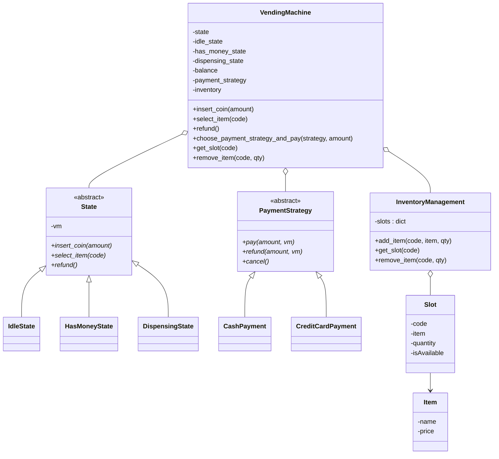

# Vending Machine — LLD

> A consolidated, rehearse-the-night-before design doc. Read top-to-bottom once, then close it and rebuild §4 and §5 from memory — that's the practice loop. This doc matches the code actually in this folder; deliberate shortcuts and one genuine bug are marked ⬜.

---

## 1. Understanding the Problem

We're designing a vending machine: a user picks a payment method, puts money in, selects an item by code, and — if it's in stock and paid for — the machine dispenses it and returns change. Then it resets for the next customer.

The one thing that makes this non-trivial — what an interviewer is really probing — is **the same operation being legal or illegal depending on where you are in the purchase.** `select_item` must do nothing before money is in; `insert_coin` must be refused mid-dispense; `refund` means different things at each step. The clean way to gate that is the **State pattern** — the machine *is* in a state, and each state permits only its own transitions. Two secondary axes ride along: **payment method varies** (cash vs. card → Strategy) and **stock/change must stay consistent** on dispense. Name the primary one out loud: *State machine for the purchase flow*; then *Strategy for payment*, and *inventory/change consistency* as the correctness detail.

---

## 2. Requirements

### Clarifying Questions

**Candidate:** What's the purchase flow — money first, then pick?
**Interviewer:** Choose a payment method and pay in, then select an item by code. If it's stocked and covered by the balance, dispense it and return change.

**Candidate:** What if someone selects an item before inserting money, or inserts money mid-dispense?
**Interviewer:** Both must be rejected cleanly — the machine shouldn't let you skip or interleave steps. That gating is the core.

**Candidate:** Multiple payment types?
**Interviewer:** Yes — cash and card at least, and easy to add more without touching the machine's flow logic.

**Candidate:** Do items have stock? What when it runs out?
**Interviewer:** Yes, each slot has a quantity. When a slot hits zero it's unavailable and selecting it is rejected.

**Candidate:** Refunds — can the user get money back before buying?
**Interviewer:** Yes, before dispensing. Once dispensing has started, no refund.

**Candidate:** Out of scope — exact-change edge cases, restocking UI, concurrency, real coin hardware?
**Interviewer:** Keep restocking to a simple `add_item`. No concurrency, no hardware, model change as a number.

### Final Requirements

**Functional**
- **Choose payment method** (cash/card) and **pay** → balance goes up.
- **Insert more coins** to top up before selecting.
- **Select item by code** → if stocked *and* balance ≥ price, **dispense** + **return change** + decrement stock, then reset.
- **Refund** the balance *before* dispensing; refused during dispense.
- Selecting an **out-of-stock or invalid** code is rejected.
- **Restock** via `add_item(code, item, qty)`.

**Non-Functional**
- Step-gating **centralized in states**, not smeared as flags.
- Payment methods **pluggable** without editing flow logic.
- Stock and change stay **consistent** on a successful dispense.

**Out of Scope**
- Concurrency, real coin/hardware, exact-change denomination logic.
- Auth, telemetry, restocking UI beyond `add_item`.

---

## 3. Core Entities and Relationships

Walking the nouns:

- **VendingMachine** — the context. Real class: holds current state, `balance`, the selected `payment_strategy`, and the `inventory`. All user actions delegate to the current state.
- **State** — idle / has-money / dispensing. Real class (abstract): the purchase-flow gate. Concretes: `IdleState`, `HasMoneyState`, `DispensingState`.
- **PaymentStrategy** — cash vs. card. Real class (abstract): pluggable payment rail. Concretes: `CashPayment`, `CreditCardPayment`. Each declares `pay` / `refund` / `cancel`.
- **InventoryManagement** — the stock keeper. Real class: `code → Slot` map, add/get/remove.
- **Slot** — one dispensing column: a code, an item, a quantity, an availability flag. Mostly data, but it owns the "am I available" invariant tied to quantity.
- **Item** — name + price. Pure **data holder** (no behavior). Barely a class, but it's the product record a slot points at.

**Entities considered and cut:**
- **`Coin` / `Denomination`** — change is modeled as a float, and exact-change logic is out of scope, so no coin objects. Cut.
- **`Money`/`Wallet`** — the machine's `balance` float suffices. Cut.
- **A `ChangeDispenser` class** — change is a one-line subtraction; a class would be ceremony. Cut (revisit only if denomination-aware change is required — §6).
- **`Product` separate from `Item`** — `Item` already is the product. No second layer. Cut.

| Entity | Responsibility |
|---|---|
| `VendingMachine` (context) | Hold state + `balance` + `payment_strategy` + `inventory`; delegate actions to state; expose `get_slot`/`remove_item` |
| `State` (abstract) + `Idle`/`HasMoney`/`Dispensing` | Permit each step's legal actions, reject the rest, drive transitions |
| `PaymentStrategy` (abstract) + `Cash`/`CreditCard` | Pluggable pay/refund/cancel rail; `pay` feeds coins into the machine |
| `InventoryManagement` | `code → Slot` map; add/get/remove; flip availability at zero stock |
| `Slot` | Hold code/item/quantity + `isAvailable` invariant |
| `Item` | Data record: name, price |

---

## 4. Class Design

### `VendingMachine` — the context

State: three pre-built state instances (`idle_state`, `has_money_state`, `dispensing_state`), a `state` pointer, `balance` (0.0), `payment_strategy` (None until chosen), and an `inventory` (pre-seeded with `A1`→Soda $1.5 ×5 and `B2`→Chips $2.0 ×3).

Public actions delegate: `insert_coin`, `select_item`, `refund` each call `self.state.<same>()`. Plus `choose_payment_strategy_and_pay(strategy, amount)` (sets the strategy and kicks off payment) and inventory pass-throughs `get_slot` / `remove_item`.

| Requirement | Tracked via |
|---|---|
| Which step we're in | `self.state` pointer (not booleans) |
| Money inserted so far | `self.balance` |
| Which rail is active | `self.payment_strategy` (None = not chosen) |
| Stock | `self.inventory` |

**Why states are pre-built once (flyweights):** all mutable data (`balance`, `payment_strategy`) lives on the machine, not the state, so one instance of each state is enough and transitions are pointer swaps. Same reasoning as any State-pattern context — states carry no per-purchase data, so they're reusable.

**Anti-pattern check — is State justified?** Yes, textbook. Distinct legal action-sets per step, the *same* method (`insert_coin`, `select_item`, `refund`) must behave differently per step (accept vs. reject vs. dispense), and a small fixed number of steps. The alternative — `if self.dispensing: ...` guards in every method — is exactly the flag-swamp the pattern removes.

### The `State` hierarchy

Abstract `State(vending_machine)` declares `insert_coin`, `select_item`, `refund`. Each concrete state implements all three.

**`IdleState`** — the entry gate; coins only accepted once a payment method is chosen:
```
insert_coin(amount):
    if vm.payment_strategy is None:
        print("Please choose a payment method before inserting coins."); return
    vm.balance += amount
    vm.state = vm.has_money_state          # advance
select_item -> "Please insert a coin first"
refund      -> "No coin to refund"
```

**`HasMoneyState`** — top-up + the purchase decision:
```
insert_coin(amount): vm.balance += amount           # stay in has_money
select_item(code):
    slot = vm.get_slot(code)
    if slot is None or not slot.isAvailable: print("Invalid item code or out of stock."); return
    if vm.balance < slot.item.price:        print("Insufficient balance ... insert $X more."); return
    vm.state = vm.dispensing_state
    vm.state._dispense_item(code)           # hand off to dispensing
refund(): vm.balance = 0; print("Refunded all coins.")
```

**`DispensingState`** — the critical section; locks out interference and does the actual vend:
```
insert_coin -> "Currently dispensing an item. Please wait."
refund      -> "Can't refund — item is dispensing."
_dispense_item(code):                       # the real work (not in the abstract interface)
    slot = vm.get_slot(code)
    change = vm.balance - slot.item.price
    vm.remove_item(code, 1)                  # decrement stock
    vm.balance -= slot.item.price
    print(f"Dispensing {slot.item.name}. Change returned: ${change:.2f}")
    vm.state = vm.idle_state                 # reset for next customer
    vm.payment_strategy = None
```

| Requirement | Which state enforces it |
|---|---|
| No select before money | `IdleState.select_item` rejects |
| No coins mid-dispense | `DispensingState.insert_coin` rejects |
| No refund mid-dispense | `DispensingState.refund` rejects |
| Stock / balance check | `HasMoneyState.select_item` guards before dispensing |
| Reset after vend | `DispensingState._dispense_item` → idle, strategy cleared |

**Two honest call-outs on the built code:**

⬜ **The change/balance bug.** `_dispense_item` computes `change = balance - price`, then does `balance -= price` — which *leaves the change sitting in `balance`*. It prints "Change returned: $X" but never zeroes the balance, so the change is both "returned" and retained. The fix is `vm.balance = 0` after computing change (the machine gives back everything above the price and keeps nothing). Flag this in an interview; it's the kind of state-consistency slip reviewers look for.

⬜ **`_dispense_item` isn't in the `State` interface.** It's a method only on `DispensingState`, called via `vm.state._dispense_item(code)` right after the transition. That works but leaks a concrete method through the abstract pointer. Cleaner: have `HasMoneyState.select_item` call a well-named entry that the dispensing state owns, or fold the dispense into the transition. Also note `DispensingState.select_item` is a separate public path that just prints a message — a second, unused-in-the-happy-path entry that's worth tidying.

### `PaymentStrategy` — pluggable rails

Abstract: `pay(amount, vm)`, `refund(amount, vm)`, `cancel()`. Concretes `CashPayment` and `CreditCardPayment` both implement `pay` by printing and then calling `vm.insert_coin(amount)` — i.e. **payment funnels money into the machine through the same `insert_coin` path**, so the state machine still governs whether the coins are accepted.

```
choose_payment_strategy_and_pay(strategy, amount):
    self.payment_strategy = strategy        # set first, so IdleState.insert_coin accepts
    strategy.pay(amount, self)              # -> vm.insert_coin(amount) -> state transition
```

**Why set the strategy *before* calling `pay`?** `IdleState.insert_coin` rejects coins when `payment_strategy is None`. Setting it first is what unlocks the insert — the ordering is load-bearing, not incidental.

**Anti-pattern check — Strategy for two payment types?** Justified: stated variation ("easy to add more without touching flow logic") and already two implementations. Without it, `insert_coin`/`choose_payment` would branch on a payment-type string. Note the payment Strategy and the purchase State are **orthogonal** — State gates *when* money is accepted; Strategy decides *how* it's tendered. Keeping them separate avoids a combinatorial `CashHasMoneyState` × `CardHasMoneyState` explosion.

### `InventoryManagement` + `Slot`

`InventoryManagement`: `slots: dict[code, Slot]`. `add_item` (top up existing or create), `get_slot`, `remove_item` (decrement, flip `isAvailable=False` at zero). `Slot`: `code`, `item`, `quantity`, `isAvailable = quantity > 0`.

| Requirement | Tracked via |
|---|---|
| Out-of-stock rejection | `slot.isAvailable` flipped to False when `quantity == 0` |
| Restock | `add_item` increments existing slot's quantity |
| Price/name lookup | `slot.item.price` / `slot.item.name` |

**Why an `isAvailable` flag instead of just checking `quantity > 0` at read time?** Mild redundancy — the flag must be kept in sync with quantity (it is: `remove_item` and `add_item` both maintain it). A single source of truth (`quantity > 0`) would be less error-prone. Worth noting as a small design smell: two fields that can drift. Not wrong, but a reviewer may prefer the derived check.

### Class diagram



---

## 5. Implementation

Hard part from §1: **the purchase-flow gating** (State), with the **payment funnel** and **dispense consistency** as the two details that make it correct. We build State first, then trace a full purchase and the rejection paths.

### The core mechanism — from flags to State

**Bad — flags on the machine.**
*Approach:* `has_money`, `dispensing` booleans; every method opens with `if not has_money: return`, `if dispensing: return`.
*Challenges:* Guard blocks copy-pasted everywhere and must stay in sync; illegal combos (`dispensing and not has_money`) representable; adding a step edits every method.
*Tradeoffs:* Fast to write, rots fast. The `insert_coin`-during-dispense rule and the `select`-before-money rule end up scattered across unrelated methods.

**Good — one `stage` enum + per-method switch.**
*Approach:* Single `stage` enum, each method switches on it.
*Challenges:* Kills the illegal-combo bug, but every method still carries the full switch and transitions are duplicated.
*Tradeoffs:* Acceptable for a 3-step machine; still smears per-step behavior across methods.

**Great — State pattern (what's built).**
*Approach:* Each step is an object implementing `insert_coin`/`select_item`/`refund`. The machine delegates; each state does its legal actions (and may reassign `vm.state`) and rejects the rest. All "being idle" rules live in `IdleState`.
*Tradeoffs:* More classes; payoff is each step is one readable file, transitions are explicit, and adding a step is additive.

```python
# vending_machine.py — context delegates; pre-seeds inventory
class VendingMachine:
    def __init__(self):
        self.idle_state = IdleState(self)
        self.has_money_state = HasMoneyState(self)
        self.dispensing_state = DispensingState(self)
        self.state = self.idle_state
        self.balance = 0.0
        self.payment_strategy = None
        self.inventory = InventoryManagement()
        self.inventory.add_item("A1", Item("Soda", 1.5), 5)
        self.inventory.add_item("B2", Item("Chips", 2.0), 3)

    def insert_coin(self, amount): self.state.insert_coin(amount)
    def select_item(self, code):   self.state.select_item(code)
    def refund(self):              self.state.refund()

    def choose_payment_strategy_and_pay(self, strategy, amount):
        self.payment_strategy = strategy          # unlock IdleState.insert_coin
        self.payment_strategy.pay(amount, self)    # -> insert_coin -> transition

    def get_slot(self, code):        return self.inventory.get_slot(code)
    def remove_item(self, code, q):  self.inventory.remove_item(code, q)
```

**Why route payment through `insert_coin` instead of setting `balance` directly?** So the *state machine* — not the payment strategy — decides whether money is accepted. `CashPayment.pay` calling `vm.insert_coin(amount)` means an insert during `DispensingState` is still refused, regardless of rail. The strategy handles *how you pay*; the state handles *whether it lands*.

### Verification trace — full happy purchase

Fresh machine (idle, balance 0, strategy None, A1 Soda $1.5 ×5). User: `choose_payment_strategy_and_pay(CashPayment(), 2.5)` then `select_item("A1")`.

| Step | Call | Logic | Machine after |
|---|---|---|---|
| 1 | `choose_..._and_pay(cash, 2.5)` | set `payment_strategy=cash`; `cash.pay(2.5)` → `insert_coin(2.5)` | strategy=cash |
| 2 | (inside) `IdleState.insert_coin(2.5)` | strategy set → `balance += 2.5` → **HasMoney** | state=HasMoney, balance=2.5 |
| 3 | `select_item("A1")` | `HasMoneyState`: slot A1 available, 2.5 ≥ 1.5 → **Dispensing** → `_dispense_item("A1")` | state=Dispensing |
| 4 | (inside) `_dispense_item("A1")` | `change=2.5-1.5=1.0`; `remove_item(A1,1)` → qty 4; `balance-=1.5` → 1.0; print change $1.00; → **Idle**, strategy=None | state=Idle, balance=**1.0** ⬜, A1 qty=4 |

Step 4 exposes the ⬜ change bug from §4: it prints "Change returned $1.00" but leaves `balance = 1.0`. With the fix (`vm.balance = 0` after computing change), the machine ends at balance 0 — returned everything above price, kept nothing — which is the correct end state. The stock decrement (5→4) and the reset-to-idle/clear-strategy are correct.

### Verification trace — the rejection paths (the whole point of State)

From a fresh machine (`IdleState`):
```
select_item("A1")  -> IdleState.select_item -> "Please insert a coin first"   # no money yet
refund()           -> IdleState.refund      -> "No coin to refund"
```
Mid-dispense (`DispensingState`, hypothetically before reset):
```
insert_coin(1.0)   -> "Currently dispensing an item. Please wait."
refund()           -> "Can't refund — item is dispensing."
```
Insufficient balance in `HasMoneyState` (balance 1.0, select B2 $2.0):
```
select_item("B2")  -> "Insufficient balance. Please insert $1.00 more."   # stays HasMoney, no vend
```
Every rejection is *local to the state* — the machine never runs an `if`; it delegates and the state says no. That's the flag-swamp avoided.

### Why not compute change with denominations?
Out of scope — change is a float. A real machine must return change in available coins and can *fail to make exact change*, which would add a `ChangeDispenser` and a pre-dispense check. Modeling it as subtraction is the deliberate simplification; name it so the interviewer knows you know (see §6).

---

## 6. Extensibility

**Add a payment rail — UPI, wallet, contactless `(Mid+)`.** One new `PaymentStrategy` subclass whose `pay` calls `vm.insert_coin(amount)` like the others. No state or machine change — the exact payoff of the Strategy abstraction.

**Denomination-aware change + exact-change guard `(Mid+)`.** Introduce a `ChangeDispenser` holding coin counts; before dispensing, `HasMoneyState.select_item` (or the dispensing entry) checks whether exact change is makeable and rejects otherwise ("exact change only"). This touches the dispense path and adds a class, but the state machine shape is untouched — the change logic slots behind the existing "can I dispense?" guard.

**Fix change/balance consistency + tidy the dispense seam `(Mid+)`.** Zero `balance` after returning change, move `_dispense_item` behind the `State` interface (or fold it into the transition), and remove the stray `DispensingState.select_item` path. Small, high-signal cleanups a careful candidate volunteers.

**Restocking, low-stock alerts, telemetry `(Senior)`.** Add an observer on `InventoryManagement` that fires when a slot crosses a low-stock threshold (mirrors the inventory-management problem's pattern). `remove_item` becomes the notification point; consumers (a restock queue, a dashboard) subscribe. Recognizing this reuses the Observer pattern from a sibling problem — rather than bolting alerts into `remove_item` inline — is the senior-level connection.

---

## 7. What's Expected at Each Level

**Junior**
- Model `VendingMachine`, `Slot`, `Item`, and a working coin→select→dispense flow with *some* gating.
- Stock decrement and an out-of-stock rejection.

**Mid-level**
- Reach for State deliberately; explain why flags don't scale.
- Payment as a Strategy that funnels through `insert_coin`, and articulate State vs. Strategy as orthogonal (when-accepted vs. how-paid).
- Keep inventory behind its own manager; catch the `isAvailable`-vs-`quantity` redundancy.

**Senior**
- Own the flyweight-states + context-owned data decision, and the load-bearing "set strategy before pay" ordering.
- Catch the change/balance double-count bug and the leaked `_dispense_item` seam, and propose exact-change denomination handling as the real-world gap.
- Connect low-stock alerting to the Observer pattern rather than inlining it — and defend *not* over-modeling coins/change until a requirement demands it.
